# MODUL 3
# KOMUNIKASI SERIAL DAN INTERFACING

---

## Daftar Isi
- [MODUL 3](#modul-3)
- [KOMUNIKASI SERIAL \& INTERFACING MODUL (UART/I2C/SPI/DMA)](#komunikasi-serial--interfacing-modul-uarti2cspidma)
  - [Daftar Isi](#daftar-isi)
  - [A. Capaian Pembelajaran](#a-capaian-pembelajaran)
  - [B. Alat dan Bahan](#b-alat-dan-bahan)
  - [C. Dasar Teori](#c-dasar-teori)
    - [C.1 UART (Universal Asynchronous Receiver-Transmitter)](#c1-uart-universal-asynchronous-receiver-transmitter)
    - [C.2 I2C (Inter-Integrated Circuit)](#c2-i2c-inter-integrated-circuit)
    - [C.3 SPI (Serial Peripheral Interface)](#c3-spi-serial-peripheral-interface)
    - [C.4 DMA (Direct Memory Access)](#c4-dma-direct-memory-access)
    - [C.5 SPI ke Ethernet (W5500)](#c5-spi-ke-ethernet-w5500)
  - [D. Persiapan Sebelum Praktikum](#d-persiapan-sebelum-praktikum)
  - [E. Kegiatan Praktikum](#e-kegiatan-praktikum)
    - [PERCOBAAN 1 — Komunikasi UART Antar ESP32](#percobaan-1--komunikasi-uart-antar-esp32)
    - [PERCOBAAN 2 — Interfacing Multi-Device I2C: OLED + MPU6500](#percobaan-2--interfacing-multi-device-i2c-oled--mpu6500)
    - [PERCOBAAN 3 — Interfacing SPI: IMU MPU6500](#percobaan-3--interfacing-spi-imu-mpu6500)
    - [PERCOBAAN 4 — DMA: Pembacaan IMU MPU6500 via SPI dengan DMA](#percobaan-4--dma-pembacaan-imu-mpu6500-via-spi-dengan-dma)
    - [PERCOBAAN 5 — Komunikasi Ethernet via SPI (W5500)](#percobaan-5--komunikasi-ethernet-via-spi-w5500)
  - [F. Tugas Modul](#f-tugas-modul)
  - [G. Referensi](#g-referensi)

---

## A. Capaian Pembelajaran

Setelah menyelesaikan Modul 3, praktikan mampu:
1. Menjelaskan prinsip kerja protokol komunikasi UART, I2C, dan SPI
2. Mengimplementasikan komunikasi UART antar dua board ESP32
3. Mengimplementasikan pembacaan dan penulisan ke lebih dari satu perangkat I2C sekaligus pada satu jalur (OLED display + IMU MPU6500)
4. Mengimplementasikan pembacaan sensor IMU MPU6500 melalui jalur SPI
5. Menjelaskan konsep DMA (*Direct Memory Access*) dan mengimplementasikan pembacaan data IMU melalui SPI dengan DMA
6. Mengimplementasikan komunikasi jaringan Ethernet melalui SPI menggunakan modul W5500

---

## B. Alat dan Bahan

1. ESP32
2. Modul Praktikum
3. Jumper Male-Male
4. Jumper Male-Female
5. IMU MPU6500
6. OLED I2C
7. W5500 LAN
8. Kable Ethernet LAN
9. Laptop

---

## C. Dasar Teori

### C.1 UART (Universal Asynchronous Receiver-Transmitter)
UART adalah komunikasi serial **tanpa kabel pengatur waktu (clock) bersama**. Agar kedua perangkat bisa saling membaca data dengan benar, keduanya harus memakai kecepatan kirim (**baud rate**) yang sama, misalnya `115200`. Komunikasi UART memakai dua jalur data: **TX** (pengirim) dan **RX** (penerima) yang dipasang **menyilang** (TX perangkat pertama ke RX perangkat kedua, dan sebaliknya) serta satu jalur **GND** bersama. Selain jalur komunikasi ke komputer (Serial Monitor), ESP32 memiliki jalur UART tambahan (**UART2**) yang bisa dipakai untuk bertukar data dengan ESP32 lain.

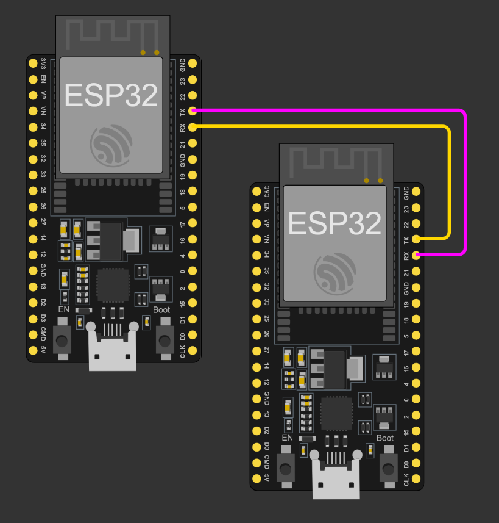

### C.2 I2C (Inter-Integrated Circuit)
I2C adalah komunikasi serial yang hanya membutuhkan dua kabel: **SDA** (jalur data) dan **SCL** (jalur pengatur waktu/clock). Keunggulan utama I2C adalah **banyak komponen bisa dihubungkan ke dua kabel yang sama**, asalkan tiap komponen punya **alamat** yang berbeda. Pada ESP32, pin standar I2C adalah **SDA = GPIO 21** dan **SCL = GPIO 22**.

Dua komponen I2C yang dipakai pada modul ini:
- **Layar OLED (SSD1306 / SH1106):** memiliki alamat `0x3C`, dikendalikan menggunakan library `U8g2`.
- **Sensor gerak IMU MPU6500:** memiliki alamat `0x68` (saat pin `AD0` dihubungkan ke `GND`), dibaca menggunakan library bawaan `Wire`.

> **Catatan:** Modul MPU6500 bisa bekerja dalam mode **I2C** maupun **SPI**. Jika pin **CS/NCS** dihubungkan tetap ke **3.3V**, sensor bekerja dalam mode **I2C** (Percobaan 2). Jika pin **CS/NCS** dihubungkan ke pin GPIO ESP32 sebagai pemilih perangkat, sensor bekerja dalam mode **SPI** (Percobaan 3 dan 4).

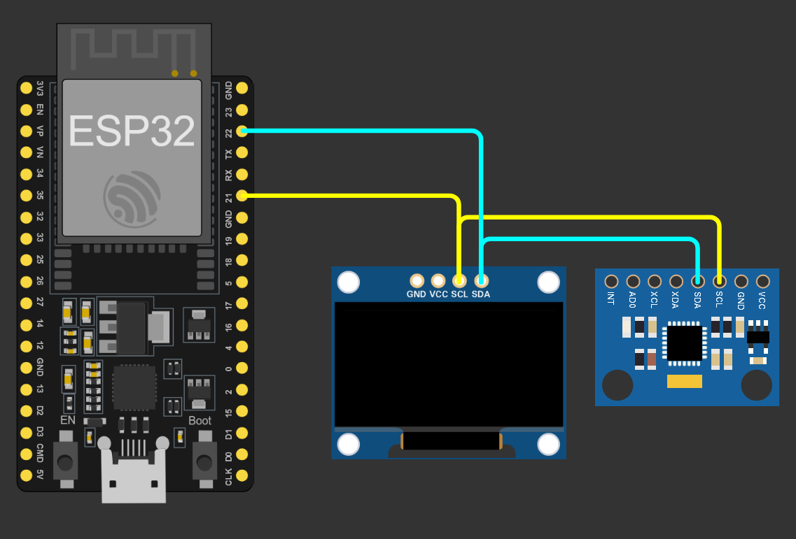

### C.3 SPI (Serial Peripheral Interface)
SPI adalah komunikasi serial berkecepatan tinggi yang mampu mengirim dan menerima data secara bersamaan menggunakan empat kabel:
- **MOSI** (*Master Out Slave In*): jalur kirim data dari ESP32 ke sensor
- **MISO** (*Master In Slave Out*): jalur terima data dari sensor ke ESP32
- **SCK** (*Serial Clock*): jalur pengatur waktu (clock)
- **CS** (*Chip Select*): kabel pemilih perangkat yang sedang diajak berkomunikasi

Berbeda dengan I2C yang memakai alamat, SPI memilih perangkat tujuan menggunakan kabel **CS** tersendiri untuk tiap komponen. SPI membutuhkan lebih banyak kabel dibanding I2C, tetapi kecepatan transfer datanya jauh lebih tinggi.

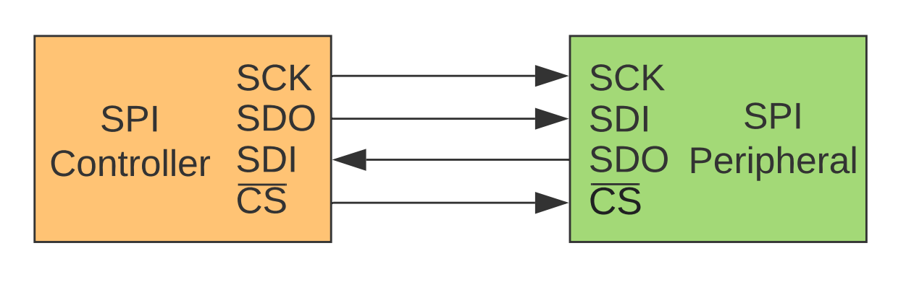

*Gambar 3: Diagram blok koneksi SPI Controller (Master) dan Peripheral (Slave). SDO/SDI pada gambar setara dengan MOSI/MISO — SDO Controller = MOSI, SDI Controller = MISO.*

### C.4 DMA (Direct Memory Access)
Pada komunikasi SPI biasa (*blocking*), prosesor (CPU) harus mengurus pengiriman dan penerimaan data **satu per satu (byte demi byte)** sehingga waktu kerja CPU habis untuk menunggu transfer selesai. Dengan **DMA (*Direct Memory Access*)**, proses pemindahan data antara sensor dan memori ditangani langsung oleh perangkat keras DMA di latar belakang. CPU cukup memberi perintah satu kali di awal untuk mengambil sekumpulan data sekaligus, lalu menunggu hasilnya selesai.

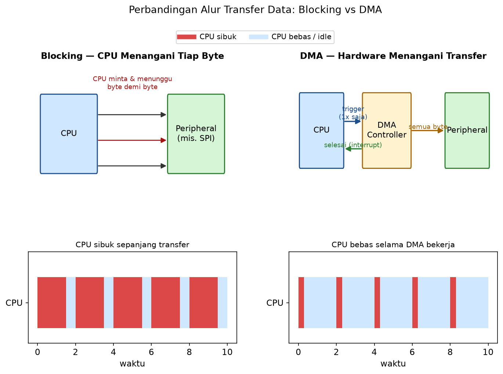

*Gambar 4: Diagram blok perbandingan alur transfer data blocking (CPU menangani tiap byte) vs DMA (CPU hanya memicu lalu menunggu, hardware DMA menangani transfer)*

### C.5 SPI ke Ethernet (W5500)
Selain untuk sensor, jalur SPI juga dapat digunakan untuk menghubungkan ESP32 ke modul jaringan kabel (**Ethernet W5500**). Chip W5500 sudah memiliki pengolah jaringan bawaan di dalamnya. Cukup dengan mengatur alamat IP lewat `Ethernet.begin()`, modul W5500 sudah bisa langsung merespons perintah `ping` dari komputer tanpa perlu kode tambahan di dalam `loop()`.

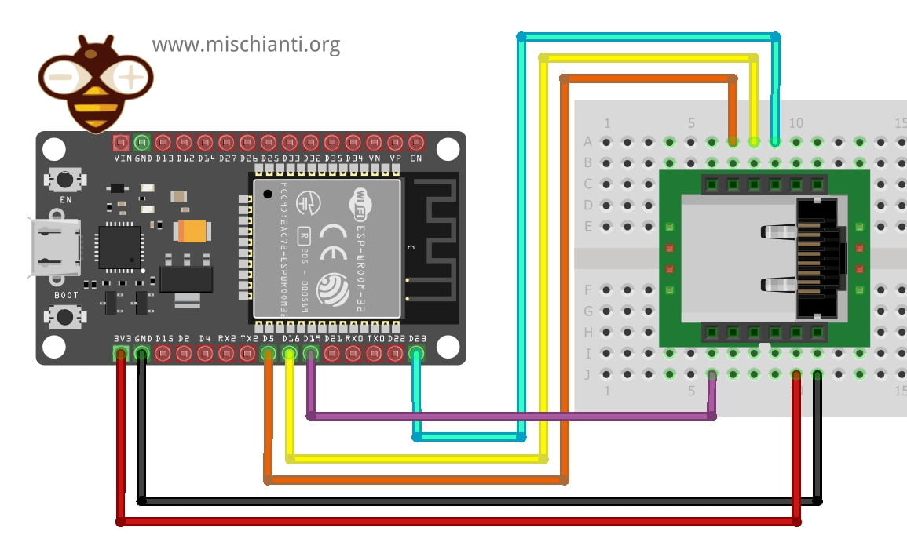

*Gambar 5: Diagram wiring SPI antara ESP32 dan modul W5500, beserta koneksi RJ45 ke jaringan lokal yang sama dengan PC*

---

## D. Persiapan Sebelum Praktikum

1. Pastikan PlatformIO sudah terinstal (lihat **[setup_vscode_platformio.md](setup_vscode_platformio.md)**)
2. Siapkan **dua board ESP32** untuk Percobaan 1 (satu sebagai pengirim/Transmitter dan satu sebagai penerima/Receiver)
3. Buat project baru untuk Modul 3:
   - Name: `modul3-komunikasi-serial`
   - Board: **"Espressif ESP32 Dev Module"**
   - Framework: **Arduino**
4. Pastikan `platformio.ini` berisi:
   ```ini
   [env:esp32dev]
   platform = espressif32
   board = esp32dev
   framework = arduino
   ```
5. Tambahkan library berikut pada `platformio.ini` saat dibutuhkan:
   - Percobaan 2 (OLED): `lib_deps = olikraus/U8g2@^2.35.0`
   - Percobaan 5 (Ethernet W5500): `lib_deps = arduino-libraries/Ethernet@^2.0.2`

---

## E. Kegiatan Praktikum

### PERCOBAAN 1 — Komunikasi UART Antar ESP32

#### LAKUKAN PERCOBAAN INI BERSAMA KELOMPOK LAIN DI SEBELAHMU

**Skema Rangkaian:**

| Board | Pin | Terhubung ke |
|---|---|---|
| ESP32 Transmitter — TX2 | GPIO 17 | RX2 (GPIO 16) pada ESP32 Receiver |
| ESP32 Transmitter — RX2 | GPIO 16 | TX2 (GPIO 17) pada ESP32 Receiver |
| ESP32 Transmitter — GND | GND | GND pada ESP32 Receiver |

> Kedua board tetap terhubung ke PC melalui USB masing-masing (untuk power dan Serial Monitor UART0), sehingga total terdapat 3 kabel yang menghubungkan kedua board: TX↔RX (silang) dan GND bersama.

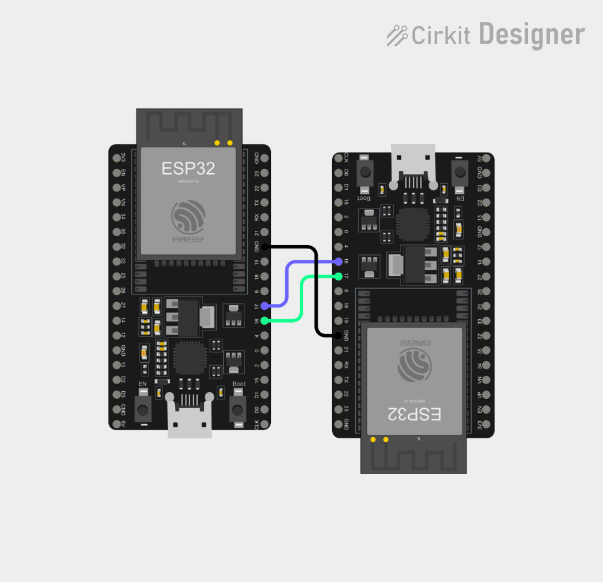

*Gambar 6: Diagram wiring komunikasi UART2 silang antara dua board ESP32 (GPIO 17 ke GPIO 16, GPIO 16 ke GPIO 17, dan GND ke GND)*

**`platformio.ini`** (sama untuk project Transmitter maupun Receiver):
```ini
[env:esp32dev]
platform = espressif32
board = esp32dev
framework = arduino
monitor_speed = 115200

```

**Langkah Kerja:**
#### Salah satu kelompok menjadi Transmitter dan yang lain menjadi Receiver. kemudian percobaan diulang lagi dengan berganti posisi, yang tadinya Receiver menjadi Transmitter dan sebaliknya.

1. Upload program sesuai dengan peran kelompokmu. 
2. Hubungkan kedua board sesuai skema di atas: `TX2` (GPIO 17) ke `RX2` (GPIO 16) secara menyilang, serta satukan `GND` kedua board
3. Buka Serial Monitor (`115200` baud) pada Receiver
4. Amati pesan `"Hello ESP32!"` yang dikirim oleh Transmitter dan diterima oleh Receiver setiap 1 detik

**Kode Program (ESP32 Transmitter):**
```cpp
#include <Arduino.h>

HardwareSerial UART(2);

int counter = 0;

void setup() {
    Serial.begin(115200);
    UART.begin(115200, SERIAL_8N1, 16, 17);

    Serial.println("ESP32 Transmitter Started");
}

void loop() {
    counter++;

    UART.print("Data dari transmitter: ");
    UART.println(counter);

    Serial.print("Data terkirim: ");
    Serial.println(counter);

    delay(1000);
}
```

**Kode Program (ESP32 Receiver):**
```cpp
#include <Arduino.h>

HardwareSerial UART(2);

void setup() {
    Serial.begin(115200);
    UART.begin(115200, SERIAL_8N1, 16, 17); // RX, TX

    Serial.println("ESP32 Receiver");
}

void loop() {
    if (UART.available()) {
        String data = UART.readStringUntil('\n');

        Serial.print("Data diterima: ");
        Serial.println(data);
    }
}
```

**Penjelasan Kode:**
| Bagian | Penjelasan |
|---|---|
| `HardwareSerial UART(2)` | Membuat objek UART hardware kedua (UART2) pada ESP32, terpisah dari `Serial` (UART0) yang digunakan untuk Serial Monitor |
| `UART.begin(115200, SERIAL_8N1, 16, 17)` | Menginisialisasi UART2 dengan baud rate 115200, format data 8N1 (8 data bit, no parity, 1 stop bit), pin RX=16 dan TX=17 |
| `UART.println(...)` | Mengirim data melalui UART2 ke board lain |
| `UART.available()` | Memeriksa apakah ada data masuk yang siap dibaca pada buffer UART2 |
| `UART.readStringUntil('\n')` | Membaca data hingga menemukan karakter newline, sesuai data yang dikirim menggunakan `println()` |

---

### PERCOBAAN 2 — Interfacing Multi-Device I2C: OLED + MPU6500

**Tujuan:**
Mahasiswa mampu mengimplementasikan interfacing lebih dari satu modul I2C nyata sekaligus pada satu bus (OLED display dan IMU MPU6500 dalam mode I2C).

**Skema Rangkaian:**

| Komponen | Pin ESP32 | Keterangan |
|---|---|---|
| OLED — SDA | GPIO 21 | Bus I2C default — **dibagi bersama** dengan MPU6500 |
| OLED — SCK | GPIO 22 | Bus I2C default — **dibagi bersama** dengan MPU6500 |
| OLED — VCC / GND | 3.3V / GND | Periksa datasheet modul (umumnya toleran 3.3–5V) |
| MPU6500 — SDA (pin SDI pada mode SPI) | GPIO 21 | Bus I2C default — pin **sama persis** dengan OLED |
| MPU6500 — SCL (pin SCLK pada mode SPI) | GPIO 22 | Bus I2C default — pin **sama persis** dengan OLED |
| MPU6500 — AD0 (pin SDO pada mode SPI) | GND | Mengunci alamat I2C MPU6500 pada `0x68` (jika ke 3.3V menjadi `0x69`) |
| MPU6500 — CS/NCS | **3.3V (ditarik tetap, bukan di-toggle)** | **Wajib** — inilah yang memilih mode I2C, berbeda dari Percobaan 3–4 di mana CS di-toggle sebagai chip select SPI |
| MPU6500 — VCC / GND | 3.3V / GND | MPU6500 umumnya hanya toleran 3.3V |

> Kedua perangkat dihubungkan ke **pin SDA dan SCL yang sama** karena memiliki alamat yang berbeda (OLED = `0x3C`, MPU6500 = `0x68`).

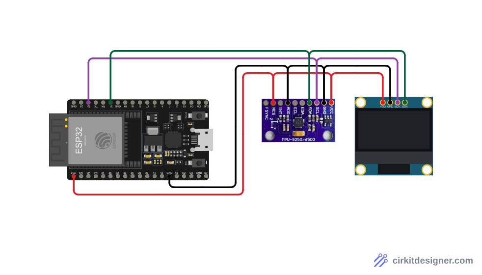

*Gambar 7: Wiring OLED dan MPU6500 berbagi bus I2C (SDA/SCL) yang sama pada ESP32*

**`platformio.ini`:**
```ini
[env:esp32dev]
platform = espressif32
board = esp32dev
framework = arduino
monitor_speed = 115200
lib_deps = olikraus/U8g2@^2.35.0
```

**Langkah Kerja:**
1. Rangkai OLED dan MPU6500 pada jalur `SDA` (GPIO 21) dan `SCL` (GPIO 22) yang sama sesuai skema di atas (pastikan pin `CS/NCS` MPU6500 terhubung ke `3.3V` dan `AD0` ke `GND`)
2. Tulis kode program di bawah pada `src/main.cpp`. lalu **Build** dan **Upload**
3. Buka Serial Monitor (`115200` baud)
4. Gerakkan dan miringkan sensor MPU6500, lalu amati perubahan nilai akselerometer (`AX, AY, AZ`) dan giroskop (`GX, GY, GZ`) yang tampil bersamaan pada layar OLED dan Serial Monitor

**Kode Program (OLED + MPU6500 pada Satu Bus I2C):**
```cpp
#include <Arduino.h>
#include <Wire.h>
#include <U8g2lib.h>

#define SDA_PIN 21
#define SCL_PIN 22

#define MPU_ADDR 0x68
#define OLED_ADDR 0x3C

// ==================== PILIH CHIP OLED ====================
// Aktifkan SATU baris saja, sesuai chip pada modul OLED Anda
#define OLED_SSD1306
// #define OLED_SH1106

#if defined(OLED_SSD1306)
U8G2_SSD1306_128X64_NONAME_F_HW_I2C oled(
    U8G2_R0,
    U8X8_PIN_NONE
);
#elif defined(OLED_SH1106)
U8G2_SH1106_128X64_NONAME_F_HW_I2C oled(
    U8G2_R0,
    U8X8_PIN_NONE
);
#endif

// Menulis satu register MPU6500
bool writeRegister(uint8_t reg, uint8_t value) {
    Wire.beginTransmission(MPU_ADDR);
    Wire.write(reg);
    Wire.write(value);
    return Wire.endTransmission() == 0;
}

// Membaca beberapa register MPU6500
bool readRegisters(uint8_t reg, uint8_t *data, uint8_t len) {
    Wire.beginTransmission(MPU_ADDR);
    Wire.write(reg);

    if (Wire.endTransmission(false) != 0) {
        return false;
    }

    uint8_t received = Wire.requestFrom(
        (uint8_t)MPU_ADDR,
        len,
        (uint8_t)true
    );

    if (received != len) {
        while (Wire.available()) Wire.read();
        return false;
    }

    for (uint8_t i = 0; i < len; i++) {
        data[i] = Wire.read();
    }

    return true;
}

// Menggabungkan byte high dan low menjadi signed 16-bit
int16_t toInt16(uint8_t highByte, uint8_t lowByte) {
    return (int16_t)(((uint16_t)highByte << 8) | lowByte);
}

bool initMPU6500() {
    // Bangunkan sensor dari mode sleep
    if (!writeRegister(0x6B, 0x00)) return false;
    delay(100);

    // Gyroscope: +/- 250 derajat/detik
    if (!writeRegister(0x1B, 0x00)) return false;

    // Accelerometer: +/- 2g
    if (!writeRegister(0x1C, 0x00)) return false;

    // Aktifkan digital low-pass filter
    if (!writeRegister(0x1A, 0x03)) return false;

    return true;
}

void setup() {
    Serial.begin(115200);

    Wire.begin(SDA_PIN, SCL_PIN);
    Wire.setClock(100000);

    // Inisialisasi OLED
    oled.setI2CAddress(OLED_ADDR * 2);
    oled.begin();

    oled.setFont(u8g2_font_6x12_tr);
    oled.clearBuffer();
    oled.drawStr(0, 20, "MPU6500 + OLED");
    oled.drawStr(0, 40, "Initializing...");
    oled.sendBuffer();

    // Periksa komunikasi MPU6500
    uint8_t whoAmI = 0;

    if (!readRegisters(0x75, &whoAmI, 1)) {
        Serial.println("Gagal membaca MPU6500!");

        oled.clearBuffer();
        oled.drawStr(0, 25, "MPU I2C ERROR");
        oled.sendBuffer();

        while (true) delay(100);
    }

    Serial.printf("WHO_AM_I: 0x%02X\n", whoAmI);

    if (!initMPU6500()) {
        Serial.println("Inisialisasi MPU6500 gagal!");
        while (true) delay(100);
    }

    oled.clearBuffer();
    oled.drawStr(0, 25, "MPU6500 Ready");
    oled.sendBuffer();

    delay(500);
}

void loop() {
    uint8_t data[14];

    // Baca data akselerometer, suhu, dan giroskop
    if (!readRegisters(0x3B, data, 14)) {
        Serial.println("Error membaca data I2C!");
        delay(200);
        return;
    }

    int16_t axRaw = toInt16(data[0], data[1]);
    int16_t ayRaw = toInt16(data[2], data[3]);
    int16_t azRaw = toInt16(data[4], data[5]);

    int16_t gxRaw = toInt16(data[8], data[9]);
    int16_t gyRaw = toInt16(data[10], data[11]);
    int16_t gzRaw = toInt16(data[12], data[13]);

    // Konversi ke satuan fisik
    float ax = axRaw / 16384.0f;
    float ay = ayRaw / 16384.0f;
    float az = azRaw / 16384.0f;

    float gx = gxRaw / 131.0f;
    float gy = gyRaw / 131.0f;
    float gz = gzRaw / 131.0f;

    Serial.printf(
        "ACC[g] X:%+.2f Y:%+.2f Z:%+.2f | "
        "GYRO[dps] X:%+.1f Y:%+.1f Z:%+.1f\n",
        ax, ay, az, gx, gy, gz
    );

    // Tampilkan data pada OLED
    char line[24];

    oled.clearBuffer();
    oled.setFont(u8g2_font_5x7_tr);

    oled.drawStr(0, 8, "MPU6500 MONITOR");
    oled.drawHLine(0, 11, 128);

    snprintf(line, sizeof(line), "AX: %+.2f g", ax);
    oled.drawStr(0, 21, line);

    snprintf(line, sizeof(line), "AY: %+.2f g", ay);
    oled.drawStr(0, 30, line);

    snprintf(line, sizeof(line), "AZ: %+.2f g", az);
    oled.drawStr(0, 39, line);

    snprintf(line, sizeof(line), "GX: %+.1f dps", gx);
    oled.drawStr(0, 48, line);

    snprintf(line, sizeof(line), "GY: %+.1f dps", gy);
    oled.drawStr(0, 56, line);

    snprintf(line, sizeof(line), "GZ: %+.1f dps", gz);
    oled.drawStr(0, 64, line);

    oled.sendBuffer();

    delay(100);
}
```

**Penjelasan Kode:**
| Bagian | Penjelasan |
|---|---|
| `PILIH CHIP OLED` (`#define OLED_SSD1306` / `OLED_SH1106`) | Memilih pengaturan layar sesuai chip OLED yang dipakai (jika tampilan bergeser atau kosong, ganti ke pilihan lainnya) |
| `Wire.begin(SDA_PIN, SCL_PIN)` | Mengaktifkan jalur I2C satu kali di awal untuk dipakai bersama oleh OLED dan MPU6500 |
| `OLED_ADDR` (`0x3C`) dan `MPU_ADDR` (`0x68`) | Alamat masing-masing perangkat agar data tidak tertukar meskipun memakai kabel SDA dan SCL yang sama |
| `initMPU6500()` | Mengaktifkan sensor MPU6500 dari mode tidur serta mengatur batas ukur akselerometer (±2g) dan giroskop (±250 °/s) |
| `readRegisters(0x3B, data, 14)` | Membaca 14 byte data sensor sekaligus (akselerometer, suhu, dan giroskop), lalu digabungkan menjadi nilai 16-bit oleh `toInt16()` |
| `axRaw / 16384.0f` dan `gxRaw / 131.0f` | Mengubah nilai mentah sensor menjadi satuan gravitasi (`g`) dan kecepatan putar (`°/s` atau `dps`) |
| `oled.clearBuffer()` ... `oled.sendBuffer()` | Menampilkan nilai akselerometer dan giroskop ke layar OLED setiap 100 ms |

---

### PERCOBAAN 3 — Interfacing SPI: IMU MPU6500

**Tujuan:**
Mahasiswa mampu mengimplementasikan komunikasi SPI untuk membaca data akselerometer dan giroskop dari sensor IMU MPU6500.

> **Catatan:** Percobaan ini menggunakan **modul MPU6500 yang sama** dengan Percobaan 2. Bedanya, pin **CS/NCS dihubungkan ke GPIO 5** sebagai pemilih perangkat (*Chip Select*) agar sensor bekerja dalam mode **SPI**.

**Skema Rangkaian:**

| Komponen | Pin ESP32 | Keterangan |
|---|---|---|
| MPU6500 — CS/NCS | GPIO 5 | Chip Select SPI |
| MPU6500 — MOSI (pin SDA) | GPIO 23 | Jalur kirim data dari ESP32 ke sensor |
| MPU6500 — MISO (pin AD0) | GPIO 19 | Jalur terima data dari sensor ke ESP32 |
| MPU6500 — SCK (pin SCL) | GPIO 18 | Jalur clock SPI |
| MPU6500 — VCC / GND | 3.3V / GND | Suplai daya sensor (3.3V) |

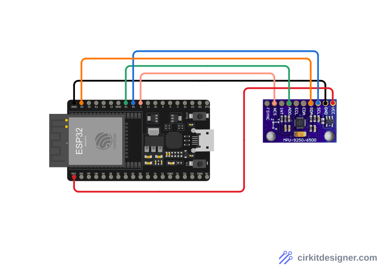

*Gambar 8: Diagram wiring modul MPU6500 ke ESP32 melalui antarmuka SPI (CS=GPIO 5, SCK=GPIO 18, MISO/AD0=GPIO 19, MOSI/SDA=GPIO 23)*

**`platformio.ini`:**
```ini
[env:esp32dev]
platform = espressif32
board = esp32dev
framework = arduino
monitor_speed = 115200

```

**Langkah Kerja:**
1. Rangkai modul MPU6500 ke ESP32 melalui jalur SPI sesuai skema di atas
2. Tulis kode program di bawah pada `src/main.cpp`, lalu klik **Build** dan **Upload**
3. Buka Serial Monitor (`115200` baud)
4. Gerakkan sensor MPU6500, lalu amati nilai akselerometer, giroskop pada Serial Monitor.
5. Kemudian buka juga Serial Plotter untuk melihat grafik dari IMU.

**Kode Program (Baca Register MPU6500 via SPI):**
```cpp
#include <Arduino.h>
#include <SPI.h>

#define SPI_SCK   18
#define SPI_MISO  19
#define SPI_MOSI  23
#define MPU_CS     5

#define REG_ACCEL_XOUT_H 0x3B
#define REG_PWR_MGMT_1   0x6B
#define REG_CONFIG       0x1A
#define REG_GYRO_CONFIG  0x1B
#define REG_ACCEL_CONFIG 0x1C
#define REG_USER_CTRL    0x6A
#define REG_WHO_AM_I     0x75

SPISettings mpuSPI(1000000, MSBFIRST, SPI_MODE0);

uint8_t readRegister(uint8_t reg) {
    SPI.beginTransaction(mpuSPI);
    digitalWrite(MPU_CS, LOW);

    SPI.transfer(reg | 0x80);
    uint8_t value = SPI.transfer(0x00);

    digitalWrite(MPU_CS, HIGH);
    SPI.endTransaction();

    return value;
}

void writeRegister(uint8_t reg, uint8_t value) {
    SPI.beginTransaction(mpuSPI);
    digitalWrite(MPU_CS, LOW);

    SPI.transfer(reg & 0x7F);
    SPI.transfer(value);

    digitalWrite(MPU_CS, HIGH);
    SPI.endTransaction();
}

int16_t combineBytes(uint8_t high, uint8_t low) {
    return (int16_t)(((uint16_t)high << 8) | low);
}

bool readSensorData(uint8_t *data, size_t length) {
    SPI.beginTransaction(mpuSPI);
    digitalWrite(MPU_CS, LOW);

    SPI.transfer(REG_ACCEL_XOUT_H | 0x80);

    for (size_t i = 0; i < length; i++) {
        data[i] = SPI.transfer(0x00);
    }

    digitalWrite(MPU_CS, HIGH);
    SPI.endTransaction();

    return true;
}

void setup() {
    Serial.begin(115200);
    delay(500);

    pinMode(MPU_CS, OUTPUT);
    digitalWrite(MPU_CS, HIGH);

    SPI.begin(SPI_SCK, SPI_MISO, SPI_MOSI, MPU_CS);
    delay(100);

    uint8_t whoAmI = readRegister(REG_WHO_AM_I);

    Serial.printf("WHO_AM_I: 0x%02X\n", whoAmI);

    if (whoAmI != 0x70) {
        Serial.println("MPU6500 tidak terdeteksi melalui SPI!");
        Serial.println("Periksa wiring, pin CS, dan tipe sensor.");

        while (true) {
            delay(1000);
        }
    }

    // Bangunkan sensor dari sleep
    writeRegister(REG_PWR_MGMT_1, 0x00);
    delay(100);

    // Nonaktifkan antarmuka I2C slave
    writeRegister(REG_USER_CTRL, 0x10);

    // Gyroscope: +/-250 derajat/detik
    writeRegister(REG_GYRO_CONFIG, 0x00);

    // Accelerometer: +/-2g
    writeRegister(REG_ACCEL_CONFIG, 0x00);

    // Low-pass filter
    writeRegister(REG_CONFIG, 0x03);

    Serial.println("MPU6500 SPI siap!");
    Serial.println("ACC (g) | GYRO (deg/s)");
}

void loop() {
    uint8_t data[14];

    unsigned long start = micros();
    readSensorData(data, sizeof(data));
    unsigned long elapsed = micros() - start;

    int16_t axRaw = combineBytes(data[0], data[1]);
    int16_t ayRaw = combineBytes(data[2], data[3]);
    int16_t azRaw = combineBytes(data[4], data[5]);

    int16_t gxRaw = combineBytes(data[8], data[9]);
    int16_t gyRaw = combineBytes(data[10], data[11]);
    int16_t gzRaw = combineBytes(data[12], data[13]);

    // Konversi accelerometer ke g
    float ax = axRaw / 16384.0f;
    float ay = ayRaw / 16384.0f;
    float az = azRaw / 16384.0f;

    // Konversi gyroscope ke derajat/detik
    float gx = gxRaw / 131.0f;
    float gy = gyRaw / 131.0f;
    float gz = gzRaw / 131.0f;

    Serial.print(">");
    Serial.print("AX:"); Serial.print(ax); Serial.print(",");
    Serial.print("AY:"); Serial.print(ay); Serial.print(",");
    Serial.print("AZ:"); Serial.print(az); Serial.print(",");
    Serial.print("GX:"); Serial.print(gx); Serial.print(",");
    Serial.print("GY:"); Serial.print(gy); Serial.print(",");
    Serial.print("GZ:"); Serial.print(gz);
    Serial.println();

    delay(100);
}
```

**Penjelasan Kode:**
| Bagian | Penjelasan |
|---|---|
| `SPI.begin(SPI_SCK, SPI_MISO, SPI_MOSI, MPU_CS)` | Mengatur pin SPI pada ESP32 (`SCK=18`, `MISO=19`, `MOSI=23`, `CS=5`) |
| `SPISettings mpuSPI(1000000, MSBFIRST, SPI_MODE0)` | Mengatur kecepatan komunikasi SPI pada 1 MHz |
| `digitalWrite(MPU_CS, LOW)` dan `HIGH` | Menarik pin `CS` ke `LOW` untuk memulai komunikasi dengan MPU6500, lalu mengembalikannya ke `HIGH` setelah selesai |
| `reg \| 0x80` dan `reg & 0x7F` | Aturan pada MPU6500: bit pertama alamat diset `1` (`\| 0x80`) saat ingin **membaca** data, dan `0` (`& 0x7F`) saat ingin **menulis** pengaturan |
| `SPI.transfer(...)` | Mengirim dan menerima 1 byte data setiap kali dipanggil (dipanggil berulang di dalam `for` untuk membaca 14 byte data sensor) |
| `elapsed = micros() - start` | Mengukur waktu (mikrodetik) yang dibutuhkan untuk membaca 14 byte data sensor dengan metode SPI biasa |
| `Serial.print(">"); ... Serial.println();` | Mencetak data dalam format `>Nama:nilai,Nama:nilai,...` yang dikenali Serial Plotter, sehingga `AX`, `AY`, `AZ`, `GX`, `GY`, `GZ` dapat diplot sebagai 6 data series sekaligus |

---

### PERCOBAAN 4 — DMA: Pembacaan IMU MPU6500 via SPI dengan DMA

**Tujuan:**
Mahasiswa mampu mengimplementasikan pembacaan data IMU MPU6500 menggunakan fitur **DMA (Direct Memory Access)** pada jalur SPI dan mengamati perbandingannya dengan pembacaan SPI biasa pada Percobaan 3.

**Skema Rangkaian:**
#### Gunakan rangkaian MPU6500 yang **sama persis** dengan **Percobaan 3** (`CS = GPIO 5`, `MOSI = GPIO 23`, `MISO = GPIO 19`, `SCK = GPIO 18` — lihat **Gambar 8**).

**`platformio.ini`:**
```ini
[env:esp32dev]
platform = espressif32
board = esp32dev
framework = arduino
monitor_speed = 115200

```

**Langkah Kerja:**
1. Gunakan rangkaian MPU6500 dari Percobaan 3 tanpa mengubah posisi kabel
2. Tulis kode program di bawah pada `src/main.cpp`, lalu klik **Build** dan **Upload**
3. Buka Serial Monitor (`115200` baud).
4. Amati pembacaan nilai akselerometer, giroskop.

**Kode Program (Pembacaan Burst MPU6500 via SPI Master + DMA):**
```cpp
#include <Arduino.h>
#include "driver/spi_master.h"
#include "esp_err.h"

// SPI pins
#define PIN_SCK   18
#define PIN_MISO  19
#define PIN_MOSI  23
#define PIN_CS     5

#define MPU_ADDR_WHO_AM_I     0x75
#define MPU_REG_PWR_MGMT_1    0x6B
#define MPU_REG_USER_CTRL     0x6A
#define MPU_REG_CONFIG        0x1A
#define MPU_REG_GYRO_CONFIG   0x1B
#define MPU_REG_ACCEL_CONFIG  0x1C
#define MPU_REG_ACCEL_XOUT_H  0x3B

#define SPI_HOST_USED SPI2_HOST

spi_device_handle_t mpuHandle;

// DMA buffers: aligned and stored in static RAM
alignas(4) uint8_t txBuf[16];
alignas(4) uint8_t rxBuf[16];

bool transferDMA(size_t bytes) {
    spi_transaction_t trans = {};
    trans.length = bytes * 8;
    trans.tx_buffer = txBuf;
    trans.rx_buffer = rxBuf;

    esp_err_t err = spi_device_queue_trans(
        mpuHandle, &trans, portMAX_DELAY
    );

    if (err != ESP_OK) {
        Serial.printf("SPI queue error: %s\n",
                      esp_err_to_name(err));
        return false;
    }

    spi_transaction_t *result = nullptr;

    err = spi_device_get_trans_result(
        mpuHandle, &result, portMAX_DELAY
    );

    if (err != ESP_OK) {
        Serial.printf("SPI DMA error: %s\n",
                      esp_err_to_name(err));
        return false;
    }

    return true;
}

bool readRegisters(uint8_t reg, uint8_t *data, size_t len) {
    if (len == 0 || len > 14) return false;

    // Total transfer rounded up to a multiple of 4 bytes
    size_t bytes = (len + 1 + 3) & ~((size_t)3);

    memset(txBuf, 0, sizeof(txBuf));
    memset(rxBuf, 0, sizeof(rxBuf));

    txBuf[0] = reg | 0x80;

    if (!transferDMA(bytes)) return false;

    memcpy(data, rxBuf + 1, len);
    return true;
}

bool writeRegister(uint8_t reg, uint8_t value) {
    memset(txBuf, 0, sizeof(txBuf));
    memset(rxBuf, 0, sizeof(rxBuf));

    txBuf[0] = reg & 0x7F;
    txBuf[1] = value;

    // Four-byte transaction for DMA alignment
    return transferDMA(4);
}

int16_t combineBytes(uint8_t high, uint8_t low) {
    return (int16_t)(((uint16_t)high << 8) | low);
}

bool initSPI() {
    spi_bus_config_t buscfg = {};
    buscfg.mosi_io_num = PIN_MOSI;
    buscfg.miso_io_num = PIN_MISO;
    buscfg.sclk_io_num = PIN_SCK;
    buscfg.quadwp_io_num = -1;
    buscfg.quadhd_io_num = -1;
    buscfg.max_transfer_sz = sizeof(txBuf);

    esp_err_t err = spi_bus_initialize(
        SPI_HOST_USED, &buscfg, SPI_DMA_CH_AUTO
    );

    if (err != ESP_OK) {
        Serial.printf("SPI bus error: %s\n",
                      esp_err_to_name(err));
        return false;
    }

    spi_device_interface_config_t devcfg = {};
    devcfg.clock_speed_hz = 1000000;
    devcfg.mode = 0;
    devcfg.spics_io_num = PIN_CS;
    devcfg.queue_size = 1;

    err = spi_bus_add_device(
        SPI_HOST_USED, &devcfg, &mpuHandle
    );

    if (err != ESP_OK) {
        Serial.printf("SPI device error: %s\n",
                      esp_err_to_name(err));
        return false;
    }

    return true;
}

void setup() {
    Serial.begin(115200);
    delay(500);

    if (!initSPI()) {
        Serial.println("SPI DMA initialization failed!");
        while (true) delay(1000);
    }

    delay(100);

    uint8_t whoAmI = 0;

    if (!readRegisters(MPU_ADDR_WHO_AM_I, &whoAmI, 1)) {
        Serial.println("WHO_AM_I read failed!");
        while (true) delay(1000);
    }

    Serial.printf("WHO_AM_I: 0x%02X\n", whoAmI);

    if (whoAmI != 0x70) {
        Serial.println("MPU6500 not identified!");
        while (true) delay(1000);
    }

    // Wake up sensor
    if (!writeRegister(MPU_REG_PWR_MGMT_1, 0x00)) {
        Serial.println("Wake-up failed!");
        while (true) delay(1000);
    }
    delay(100);

    // Disable I2C interface
    writeRegister(MPU_REG_USER_CTRL, 0x10);

    // Accelerometer: +/-2g
    writeRegister(MPU_REG_ACCEL_CONFIG, 0x00);

    // Gyroscope: +/-250 degrees/second
    writeRegister(MPU_REG_GYRO_CONFIG, 0x00);

    // Digital low-pass filter
    writeRegister(MPU_REG_CONFIG, 0x03);

    Serial.println("MPU6500 SPI DMA ready!");
}

void loop() {
    uint8_t data[14];

    unsigned long start = micros();
    bool ok = readRegisters(MPU_REG_ACCEL_XOUT_H, data, 14);
    unsigned long elapsed = micros() - start;

    if (!ok) {
        Serial.println("Sensor read failed!");
        delay(100);
        return;
    }

    int16_t axRaw = combineBytes(data[0], data[1]);
    int16_t ayRaw = combineBytes(data[2], data[3]);
    int16_t azRaw = combineBytes(data[4], data[5]);

    int16_t gxRaw = combineBytes(data[8], data[9]);
    int16_t gyRaw = combineBytes(data[10], data[11]);
    int16_t gzRaw = combineBytes(data[12], data[13]);

    float ax = axRaw / 16384.0f;
    float ay = ayRaw / 16384.0f;
    float az = azRaw / 16384.0f;

    float gx = gxRaw / 131.0f;
    float gy = gyRaw / 131.0f;
    float gz = gzRaw / 131.0f;

    Serial.print(">");
    Serial.print("AX:"); Serial.print(ax); Serial.print(",");
    Serial.print("AY:"); Serial.print(ay); Serial.print(",");
    Serial.print("AZ:"); Serial.print(az); Serial.print(",");
    Serial.print("GX:"); Serial.print(gx); Serial.print(",");
    Serial.print("GY:"); Serial.print(gy); Serial.print(",");
    Serial.print("GZ:"); Serial.print(gz);
    Serial.println();

    delay(50);
}
```

**Penjelasan Kode:**
| Bagian | Penjelasan |
|---|---|
| `spi_bus_initialize(..., SPI_DMA_CH_AUTO)` | Mengaktifkan jalur SPI beserta fitur **DMA otomatis**, sehingga perangkat keras DMA bisa memindahkan data secara langsung ke memori |
| `spi_bus_add_device()` | Mendaftarkan sensor MPU6500 pada jalur SPI dengan pin `CS = GPIO 5` dan kecepatan 1 MHz |
| `txBuf[16]` dan `rxBuf[16]` | Memori penampung (*buffer*) tempat perangkat keras DMA mengambil data yang akan dikirim dan menyimpan data yang diterima dari sensor |
| `transferDMA()` | Memerintahkan DMA untuk mengirim dan menerima seluruh paket data sekaligus dalam satu kali jalan, tanpa perlu memanggil `SPI.transfer()` berulang kali untuk tiap byte |
| `readRegisters(MPU_REG_ACCEL_XOUT_H, data, 14)` | Mengambil 14 byte data sensor sekaligus menggunakan DMA |
| `elapsed = micros() - start` | Mengukur waktu (mikrodetik) yang dibutuhkan untuk membaca 14 byte data menggunakan DMA |

---

### PERCOBAAN 5 — Komunikasi Ethernet via SPI (W5500)

**Tujuan:**
Mahasiswa mampu mengimplementasikan komunikasi jaringan Ethernet menggunakan modul W5500 melalui jalur SPI dan menguji keterhubungannya dengan komputer menggunakan perintah `ping`.

**Skema Rangkaian:**

| W5500 | Pin ESP32 | Keterangan |
|---|---|---|
| SCK | GPIO 18 | Jalur clock SPI |
| MI (MISO) | GPIO 19 | Jalur terima data SPI |
| MO (MOSI) | GPIO 23 | Jalur kirim data SPI |
| CS/SS | GPIO 5 | Chip Select |
| RST | 3.3V | Reset (ditarik ke 3.3V agar modul aktif) |
| VCC | 3.3V | Suplai daya 3.3V |
| GND | GND | Ground |

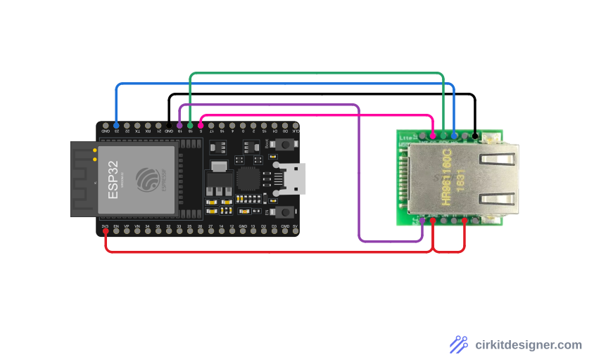

*Gambar 9: Diagram wiring modul W5500 ke ESP32 melalui jalur SPI*

**`platformio.ini`:**
```ini
[env:esp32dev]
platform = espressif32
board = esp32dev
framework = arduino
lib_deps = arduino-libraries/Ethernet@^2.0.2
monitor_speed = 115200

```

**Menyiapkan IP Statis pada PC Windows (untuk koneksi kabel RJ45 langsung ke laptop):**

Kode program memberi ESP32 alamat IP `192.168.1.177`. Agar komputer bisa berkomunikasi langsung lewat kabel RJ45, atur IP Ethernet komputer ke satu jaringan yang sama, misalnya `192.168.1.10`:

1. Buka **Settings → Network & internet → Ethernet**
2. Pada baris **IP assignment**, klik **Edit**, ubah ke **Manual**, lalu aktifkan **IPv4**
3. Isi **IP address:** `192.168.1.10` dan **Subnet mask:** `255.255.255.0` (Gateway dan DNS dikosongkan), lalu klik **Save**

#### Jika kalian tidak bisa melakukan hal ini, dimohon untuk mengulang **Praktikum Jaringan Komputer Modul 1**

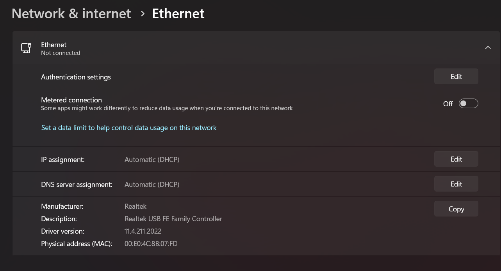

*Gambar 10: Pengaturan IP manual pada Settings Windows*

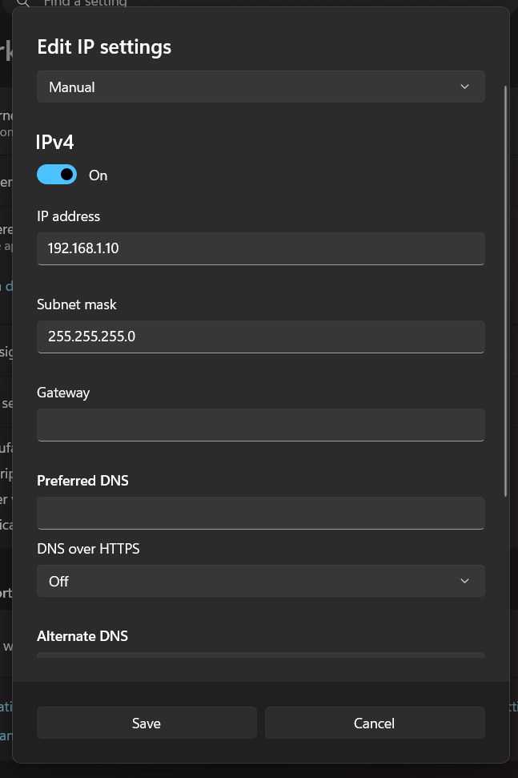

*Gambar 11: Pengaturan IP manual melalui Control Panel Windows*

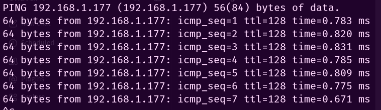

*Contoh Ping Yang Berhasil, misal kalian ga tahu*


**Langkah Kerja:**
1. Rangkai modul W5500 ke ESP32 sesuai skema di atas, lalu hubungkan kabel LAN RJ45 dari W5500 ke port Ethernet Laptop kalian
2. Atur alamat IP komputer menjadi `192.168.1.10` mengikuti panduan di atas
3. Tulis kode program di bawah pada `src/main.cpp`, lalu klik **Build** dan **Upload**
4. Buka Serial Monitor (`115200` baud) dan pastikan muncul pesan `"ESP32 + W5500 siap. IP: 192.168.1.177"`
5. Buka **Command Prompt (CMD)** di Laptop, jalankan perintah `ping 192.168.1.177`, lalu amati hasilnya.

**Kode Program (ESP32 + W5500 — Merespons Ping dari PC):**
```cpp
#include <Arduino.h>
#include <SPI.h>
#include <Ethernet.h>

// ==================== PIN SPI (VSPI default ESP32) ====================
#define PIN_SCK  18
#define PIN_MISO 19
#define PIN_MOSI 23
#define PIN_CS   5

// MAC address bebas — pastikan unik di jaringan lokal (hindari duplikat)
byte mac[] = { 0xDE, 0xAD, 0xBE, 0xEF, 0xFE, 0xED };

// IP statis — SESUAIKAN dengan subnet jaringan yang sama dengan PC
IPAddress ip(192, 168, 1, 177);

void setup() {
  Serial.begin(115200);
  delay(1000);

  // Inisialisasi SPI dengan pin custom ESP32, lalu beri tahu library CS pin yang dipakai
  SPI.begin(PIN_SCK, PIN_MISO, PIN_MOSI, PIN_CS);
  Ethernet.init(PIN_CS);

  Ethernet.begin(mac, ip);

  if (Ethernet.hardwareStatus() == EthernetNoHardware) {
    Serial.println("W5500 tidak terdeteksi -- periksa wiring SPI!");
    while (true) { delay(1000); }
  }

  if (Ethernet.linkStatus() == LinkOFF) {
    Serial.println("Peringatan: kabel Ethernet (RJ45) tidak terdeteksi terhubung.");
  }

  Serial.print("ESP32 + W5500 siap. IP: ");
  Serial.println(Ethernet.localIP());
  Serial.print("Coba dari Command Prompt Windows: ping ");
  Serial.println(Ethernet.localIP());
}

void loop() {
  // Tidak perlu kode tambahan untuk merespons PING --
  // W5500 menangani ARP & ICMP Echo Reply secara otomatis di level hardware chip
  delay(1000);
}
```

**Penjelasan Kode:**
| Bagian | Penjelasan |
|---|---|
| `SPI.begin(PIN_SCK, PIN_MISO, PIN_MOSI, PIN_CS)` | Mengatur pin komunikasi SPI antara ESP32 dan modul W5500 |
| `Ethernet.init(PIN_CS)` | Memberi tahu library `Ethernet` bahwa pin pemilih perangkat (`CS`) menggunakan `GPIO 5` |
| `Ethernet.begin(mac, ip)` | Mengatur alamat fisik (`mac`) dan alamat jaringan (`ip`) pada modul W5500 |
| `Ethernet.hardwareStatus()` | Memeriksa apakah modul W5500 sudah terhubung dengan benar ke ESP32 |
| `loop()` tidak berisi kode pemrosesan `ping` | Modul W5500 sudah memiliki pengolah jaringan bawaan di dalam chip-nya, sehingga balasan `ping` ditangani secara otomatis tanpa kode tambahan |

---

## F. Tugas Modul

**Kontrol Multi Device**


Buat simulasi dengan 2 Sensor IMU MPU6050 dan 2 OLED I2C, dimana 1 OLED menampilkal output dari 1 IMU. Gunakan I2C untuk menyambungkan 4 device tersebut sekaligus.

- Kumpulkan tangkapan layar dari hasil simulasi beserta source code-nya. (Simulasi dapat dilakukan menggunakan wokwi, cirkit, thinkercad, atau aplikasi simulasi lain yang mendukung mikrokontroler ESP32).


**Pertanyaan Analisis:**
1. Analisis bagaimana keempat perangkat bisa saling dibedakan meski berbagi pin yang sama?
2. Andaikan salah satu sensor IMU dilepas dari rangkaian, apakah tiga perangkat lainnya tetap dapat berfungsi normal tanpa perubahan kode maupun wiring? jelaskan!
3. Analisis mengapa pendekatan berbagi pin ini tidak bisa langsung diterapkan jika keempat komponen diganti dengan modul yang setiap unitnya butuh satu jalur data khusus sendiri (mis. sensor analog biasa), apa yang membuat solusi ini hanya berlaku untuk jenis komunikasi tertentu?


---

## G. Referensi
1. Espressif Systems, *ESP32 Technical Reference Manual — UART, I2C, SPI*
2. Espressif Systems, *ESP-IDF Programming Guide — SPI Master Driver*, https://docs.espressif.com/projects/esp-idf/
3. Arduino-ESP32 Core Documentation — Wire (I2C), SPI, https://docs.espressif.com/projects/arduino-esp32/
4. olikraus, *U8g2 Library Documentation*, https://github.com/olikraus/u8g2
5. Register Map Datasheet MPU6500 (InvenSense/TDK)
6. PlatformIO Documentation, https://docs.platformio.org/
7. Arduino, *Ethernet Library Documentation* (kompatibel W5100/W5200/W5500), https://www.arduino.cc/reference/en/libraries/ethernet/
8. WIZnet, *W5500 Datasheet*, https://www.wiznet.io/product-item/w5500/
