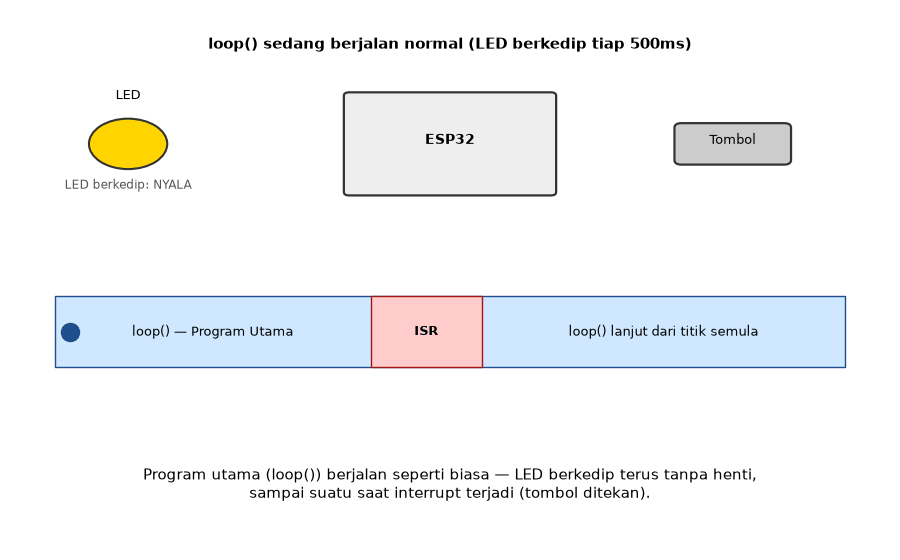
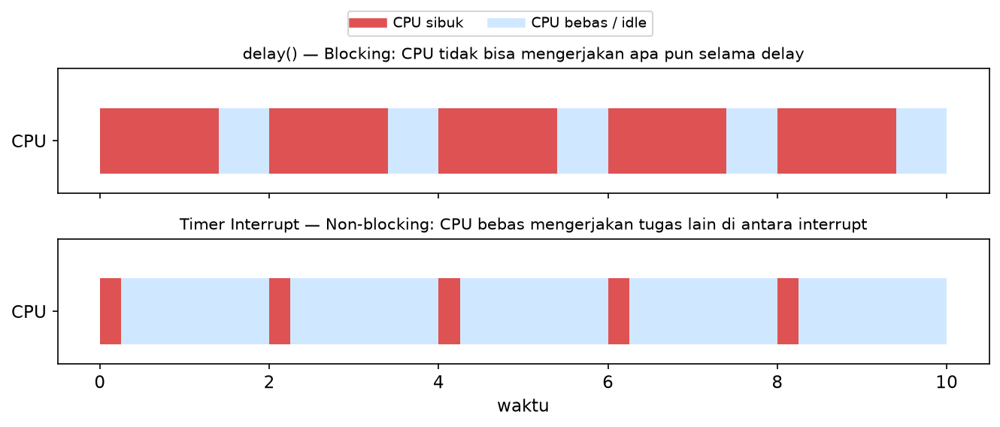
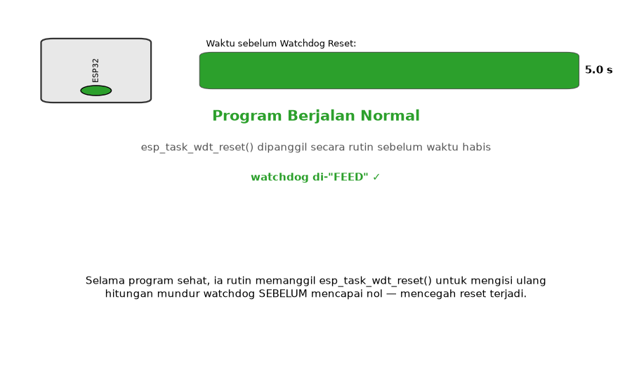
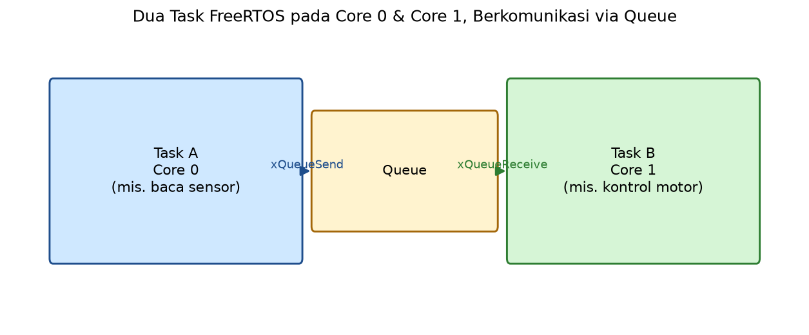
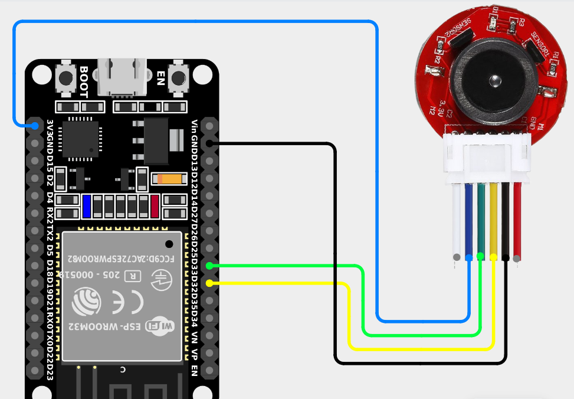

# MODUL 4
# INTERRUPT, TIMER, WATCHDOG, & MULTITASKING

---

## Daftar Isi
- [MODUL 4](#modul-4)
- [INTERRUPT, TIMER, WATCHDOG, \& MULTITASKING](#interrupt-timer-watchdog--multitasking)
  - [Daftar Isi](#daftar-isi)
  - [A. Capaian Pembelajaran](#a-capaian-pembelajaran)
  - [B. Alat dan Bahan](#b-alat-dan-bahan)
  - [C. Dasar Teori](#c-dasar-teori)
    - [C.1 External Interrupt](#c1-external-interrupt)
    - [C.2 Timer Interrupt](#c2-timer-interrupt)
    - [C.3 Watchdog Timer (WDT)](#c3-watchdog-timer-wdt)
    - [C.4 Multitasking dengan FreeRTOS](#c4-multitasking-dengan-freertos)
  - [D. Persiapan Sebelum Praktikum](#d-persiapan-sebelum-praktikum)
  - [E. Kegiatan Praktikum](#e-kegiatan-praktikum)
    - [PERCOBAAN 1 — External Interrupt pada Kondisi Sistem Hang (Manual Recovery)](#percobaan-1--external-interrupt-pada-kondisi-sistem-hang-manual-recovery)
    - [PERCOBAAN 2 — External Interrupt: Decoding Quadrature Encoder (Pulsa \& Arah)](#percobaan-2--external-interrupt-decoding-quadrature-encoder-pulsa--arah)
    - [PERCOBAAN 3 — Timer Interrupt](#percobaan-3--timer-interrupt)
    - [PERCOBAAN 4 — Watchdog Timer](#percobaan-4--watchdog-timer)
    - [PERCOBAAN 5 — Multitasking dengan FreeRTOS](#percobaan-5--multitasking-dengan-freertos)
  - [F. Tugas Modul](#f-tugas-modul)
  - [G. Referensi](#g-referensi)

---

## A. Capaian Pembelajaran

Setelah menyelesaikan Modul 4, praktikan mampu:
1. Menjelaskan mengapa external interrupt tetap dapat berfungsi meskipun program utama mengalami hang, serta memanfaatkannya sebagai mekanisme pemulihan manual (manual recovery)
2. Menjelaskan konsep interrupt sebagai alternatif polling, dan mengimplementasikan external interrupt untuk penghitungan pulsa (encoder)
3. Mengimplementasikan timer interrupt untuk menjalankan tugas periodik tanpa memblokir program utama (`delay()`)
4. Menjelaskan fungsi watchdog timer dan mengimplementasikannya untuk menjaga keandalan sistem
5. Mengimplementasikan multitasking dasar menggunakan FreeRTOS, termasuk komunikasi antar task melalui queue

---

## B. Alat dan Bahan

1. ESP32
2. Modul Praktikum
3. Jumper Male-Male
4. Jumper Male-Female
5. OLED I2C
6. Encoder Motor (Menyatu dengan motor DC Brushed)

---

## C. Dasar Teori

### C.1 External Interrupt
Pendekatan **polling** memeriksa status suatu pin secara terus-menerus di dalam `loop()`, yang kurang efisien untuk event yang jarang terjadi atau butuh respons cepat. **Interrupt** memungkinkan CPU merespons suatu event secara langsung — saat event terjadi (mis. perubahan sinyal pada pin GPIO), eksekusi program utama dihentikan sementara untuk menjalankan fungsi khusus yang disebut **ISR (Interrupt Service Routine)**, lalu kembali melanjutkan program utama.

Konsep penting terkait interrupt pada ESP32:
- **Trigger mode:** `RISING` (LOW→HIGH), `FALLING` (HIGH→LOW), atau `CHANGE` (kedua arah)
- **ISR harus singkat:** tidak boleh berisi operasi yang memblokir/lambat seperti `delay()` atau `Serial.print()` dalam jumlah banyak
- **Variabel `volatile`:** variabel yang diakses baik dari ISR maupun dari `loop()` harus dideklarasikan `volatile` agar compiler tidak melakukan optimisasi yang menyebabkan nilai terbaru tidak terbaca dengan benar
- **`IRAM_ATTR`:** menandai agar fungsi ISR dieksekusi dari RAM, bukan Flash — wajib pada ESP32 karena Flash dapat sedang diakses oleh proses lain saat interrupt terjadi
- **Proteksi variabel bersama (`portMUX_TYPE`):** karena ESP32 memiliki dua core, sepasang fungsi `noInterrupts()`/`interrupts()` (yang hanya menonaktifkan interrupt pada satu core) tidak cukup aman untuk melindungi variabel yang diakses bersama oleh ISR dan `loop()`. Pendekatan yang benar pada ESP32 adalah menggunakan **critical section** berbasis `portMUX_TYPE` beserta `portENTER_CRITICAL_ISR()`/`portEXIT_CRITICAL_ISR()` (di dalam ISR) dan `portENTER_CRITICAL()`/`portEXIT_CRITICAL()` (di luar ISR), yang benar-benar aman terhadap akses simultan dari kedua core
- **Interrupt tetap berjalan meski program hang:** karena ISR dipicu di level hardware, ISR akan tetap dieksekusi meskipun `loop()` sedang terjebak dalam kondisi blocking/infinite loop, selama interrupt global tidak dinonaktifkan — sifat ini dapat dimanfaatkan sebagai mekanisme pemulihan darurat (lihat Percobaan 1)



*Gambar 1: Animasi alur eksekusi program utama yang dijeda sesaat oleh ISR saat interrupt terjadi, lalu kembali melanjutkan program utama*

### C.2 Timer Interrupt
Selain interrupt yang dipicu oleh perubahan sinyal eksternal, ESP32 memiliki **hardware timer** internal yang dapat memicu interrupt secara **periodik** berdasarkan hitungan waktu, tanpa bergantung pada sinyal dari luar. Timer interrupt memungkinkan tugas periodik (mis. membaca sensor tiap interval tertentu) dijalankan secara presisi **tanpa memblokir** program utama — berbeda dengan `delay()` yang menghentikan seluruh eksekusi program selama periode tunggu.



*Gambar 2: Diagram garis waktu (timeline) yang membandingkan task periodik menggunakan `delay()` (blocking) vs timer interrupt (non-blocking)*

### C.3 Watchdog Timer (WDT)
Watchdog Timer adalah timer khusus yang akan **me-reset sistem secara otomatis** jika tidak "diberi makan" (direset ulang) dalam periode waktu tertentu. Tujuannya adalah menjaga keandalan sistem embedded — jika program mengalami *hang* (macet, mis. akibat infinite loop atau kondisi tak terduga), watchdog akan mendeteksi bahwa sistem tidak lagi responsif dan memicu reset otomatis agar sistem kembali berjalan normal, alih-alih macet tanpa batas waktu.



*Gambar 3: Animasi watchdog timer — program normal "memberi makan" (reset) watchdog secara berkala, dibandingkan dengan program hang yang gagal memberi makan sehingga watchdog memicu reset otomatis*

### C.4 Multitasking dengan FreeRTOS
Arduino-ESP32 core dibangun di atas **FreeRTOS**, sebuah RTOS (Real-Time Operating System) yang memungkinkan beberapa **task** berjalan secara "paralel" (sebenarnya bergantian sangat cepat oleh scheduler, atau benar-benar paralel karena ESP32 memiliki dua core CPU). Setiap task memiliki fungsi, ukuran stack, dan prioritas masing-masing, dibuat menggunakan `xTaskCreate()`/`xTaskCreatePinnedToCore()`. Task yang berjalan pada RTOS umumnya tidak menggunakan `delay()` biasa, melainkan `vTaskDelay()` agar tidak memblokir task lain secara tidak perlu. Komunikasi antar task dapat dilakukan melalui **queue** (`xQueueSend()`/`xQueueReceive()`), memungkinkan satu task mengirim data ke task lain secara aman.



*Gambar 4: Diagram dua task FreeRTOS berjalan pada Core 0 dan Core 1 ESP32, saling berkomunikasi melalui queue*

---

## D. Persiapan Sebelum Praktikum

1. Pastikan PlatformIO sudah terinstal
2. Buat project baru untuk Modul 4:
   - Name: `modul4-interrupt-timer-rtos`
   - Board: **"Espressif ESP32 Dev Module"**
   - Framework: **Arduino**
3. Pastikan `platformio.ini` berisi:
   ```ini
   [env:esp32dev]
   platform = espressif32@6.5.0
   board = esp32dev
   framework = arduino
   monitor_speed = 115200
   ```
4. Tidak ada library eksternal tambahan yang dibutuhkan pada modul ini — seluruh fitur (interrupt, timer, watchdog, FreeRTOS) sudah tersedia dalam Arduino-ESP32 core

---

## E. Kegiatan Praktikum

### PERCOBAAN 1 — External Interrupt pada Kondisi Sistem Hang (Manual Recovery)

**Tujuan:**
Mahasiswa mampu membuktikan bahwa external interrupt tetap dapat berjalan meskipun program utama (`loop()`) mengalami hang/macet total, serta memanfaatkannya sebagai mekanisme pemulihan manual (manual recovery).

#### Skema Rangkaian:

| Komponen | Pin ESP32 | Keterangan |
|---|---|---|
| Pushbutton | GPIO 27 | Satu kaki ke GPIO 27, kaki lain ke GND (pull-up). |
| OLED — SDA | GPIO 21 | Bus I2C default |
| OLED — SCK (SCL) | GPIO 22 | Bus I2C default |
| OLED — VCC / GND | 3.3V / GND | Periksa datasheet modul (umumnya toleran 3.3–5V) |

**`platformio.ini`:**
```ini
[env:esp32dev]
platform = espressif32@6.5.0
board = esp32dev
framework = arduino
monitor_speed = 115200
lib_deps = olikraus/U8g2@^2.35.0
```

**Langkah Kerja:**
1. Pasang tombol dan OLED sesuai skema.
2. Upload program normal (Langsung copas saja kode dibawah dan diupload).
3. Perhatikan animasi pada OLED dan waktunya. Kemudian tekan tombol saat program berjalan normal dan pastikan board restart.
4. Setelah itu, hapus tanda `//` (uncomment) pada `// simulateHang();` di `loop()`. Kemudian Upload Ulang.
5. Perhatikan animasi pada OLED, dalam beberapa detik animasi akan berhenti (hang). Pada saat itu terjadi, tekan tombol lagi dan pastikan board restart.
6. Analisis program, bagaimana tombol mampu merestart ESP32 padahal fungsi `loop()` sedang stuck (hang)

**Kode Program (Tombol Darurat — Restart Manual Saat Sistem Hang):**
```cpp
#include <Arduino.h>
#include <esp_system.h>
#include <Wire.h>
#include <U8g2lib.h>
#include <math.h>

#define BUTTON_PIN 27
#define SDA_PIN 21
#define SCL_PIN 22
#define OLED_ADDR 0x3C

U8G2_SSD1306_128X64_NONAME_F_HW_I2C oled(U8G2_R0, U8X8_PIN_NONE);

float angle = 0;

void IRAM_ATTR emergencyISR()
{
    // Pengecualian terhadap aturan "ISR harus singkat": karena loop()
    // mungkin sedang hang, restart HARUS dilakukan langsung di dalam ISR
    // agar benar-benar dapat memulihkan sistem kapan pun dibutuhkan
    esp_restart();
}

void drawSpinningWheel(float a)
{
    int cx = 64, cy = 28, r = 20;

    oled.clearBuffer();
    oled.drawCircle(cx, cy, r);

    int x2 = cx + (int)(r * cos(a));
    int y2 = cy + (int)(r * sin(a));
    oled.drawLine(cx, cy, x2, y2);

    oled.setFont(u8g2_font_6x10_tf);

    unsigned long currentMillis = millis();
    oled.setCursor(5, 63);
    oled.print("Waktu: ");
    oled.print(currentMillis);

    oled.sendBuffer();
}

void simulateHang()
{
    static int hangCounter = 0;
    hangCounter++;
    if (hangCounter < 40) 
    {
        return;
    }

    // Simulasi sistem hang: program terjebak di sini tanpa henti.
    // Animasi roda OLED berhenti berputar — coba tekan tombol darurat sekarang.
    Serial.println("Mensimulasikan hang! Animasi roda akan berhenti...");
    while (true)
    {
    }
}

void setup()
{
    Serial.begin(115200);
    pinMode(BUTTON_PIN, INPUT_PULLUP);

    Wire.begin(SDA_PIN, SCL_PIN);
    oled.setI2CAddress(OLED_ADDR * 2);
    oled.begin();

    attachInterrupt(digitalPinToInterrupt(BUTTON_PIN), emergencyISR, FALLING);

    Serial.println("Sistem berjalan normal. Tombol darurat siap kapan saja.");
}

void loop()
{
    drawSpinningWheel(angle);
    angle += 0.3f;
    if (angle > 2 * PI)
    {
        angle -= 2 * PI;
    }

    Serial.println("loop() berjalan normal...");
    delay(30);

    // Uncomment baris DIBAWAH berikut untuk mensimulasikan sistem hang:
    // simulateHang(); // Uncomment baris INI untuk mensimulasikan sistem hang:
    // Uncomment baris DIATAS berikut untuk mensimulasikan sistem hang:
}

```

**Penjelasan Kode:**
| Bagian | Penjelasan |
|---|---|
| `esp_restart()` dipanggil langsung di `emergencyISR()` | Berbeda dari praktik umum (ISR hanya set flag, aksi berat dilakukan di `loop()`), di sini aksi pemulihan **harus** terjadi di dalam ISR — karena jika `loop()` sedang hang, ia tidak akan pernah sempat memeriksa flag apa pun |
| `simulateHang()` (dipanggil saat di-uncomment) | Fungsi berisi `while (true) {}` yang mewakili kondisi hang nyata (mis. akibat bug, sensor yang tidak merespons, atau kondisi tak terduga lainnya) — program benar-benar berhenti merespons pada `loop()`. Dibungkus sebagai fungsi agar cukup satu baris `// simulateHang();` yang perlu di-uncomment |
| Tombol darurat tetap berfungsi saat hang | Membuktikan bahwa ISR berjalan independen dari status `loop()`, selama interrupt global tidak dinonaktifkan |
| Perbandingan dengan Watchdog (Percobaan 4) | Watchdog mendeteksi hang secara **otomatis** berdasarkan timeout tanpa perlu campur tangan manusia; tombol darurat bersifat **manual** (perlu ditekan pengguna) namun dapat merespons **lebih cepat dan kapan saja**, tanpa menunggu periode timeout — keduanya saling melengkapi, bukan saling menggantikan |

---

### PERCOBAAN 2 — External Interrupt: Decoding Quadrature Encoder (Pulsa & Arah)

**Tujuan:**
Mahasiswa mampu mengimplementasikan external interrupt untuk melakukan decoding sinyal quadrature encoder (2 channel), menghitung jumlah pulsa sekaligus arah putaran secara periodik.

#### Skema Rangkaian:

| Komponen | Pin ESP32 | Keterangan |
|---|---|---|
| Encoder — Channel A (C1, kabel Kuning) | GPIO 32 | `INPUT_PULLUP`, dipasang ke interrupt (trigger `RISING`) |
| Encoder — Channel B (C2, kabel Hijau) | GPIO 33 | `INPUT_PULLUP`, dibaca di dalam ISR untuk menentukan arah |
| Encoder — VCC (kabel Biru) | 3.3V–5V (sesuai modul) | Suplai daya sensor encoder |
| Encoder — GND (kabel Hitam) | GND | Referensi ground bersama |
| Motor DC — M1 (Merah) & M2 (Putih) | **Tidak dihubungkan** | motor diputar manual dengan tangan pada percobaan ini |



*Gambar 5: Wiring modul encoder quadrature (Channel A/kuning, Channel B/hijau, VCC/biru, GND/hitam) ke ESP32*

**`platformio.ini`:**
```ini
[env:esp32dev]
platform = espressif32@6.5.0
board = esp32dev
framework = arduino
monitor_speed = 115200

```

**Langkah Kerja:**
1. Pasang encoder sesuai skema. Kabel daya motor (kabel paling kanan dan kiri) tidak perlu dipasang.
2. Upload kode di bawah, lalu buka Serial Monitor
3. Putar motor dengan tangan ke dua arah (searah dan berlawanan jarum jam), lalu amati perubahan `Total Pulsa` dan `Arah` (CW atau CCW)
4. Putar motor secara pelan dan cepat, analisis hubungan kecepatan putar dengan nilai `Delta`
5. Tukar kabel Channel A dan Channel B tanpa mengubah kode, lalu analisis mengapa arah yang terbaca menjadi terbalik

**Kode Program (Decoding Quadrature Encoder via External Interrupt):**
```cpp
#include <Arduino.h>

#define ENCODER_A_PIN 32
#define ENCODER_B_PIN 33

volatile int32_t encoderCount = 0;
portMUX_TYPE encoderMux = portMUX_INITIALIZER_UNLOCKED;

int32_t previousCount = 0;
unsigned long previousMillis = 0;

void IRAM_ATTR encoderA_ISR()
{
    bool channelB = digitalRead(ENCODER_B_PIN);

    portENTER_CRITICAL_ISR(&encoderMux);
    if (channelB == HIGH)
    {
        encoderCount++; // arah maju (CW)
    }
    else
    {
        encoderCount--; // arah mundur (CCW)
    }
    portEXIT_CRITICAL_ISR(&encoderMux);
}

void setup()
{
    Serial.begin(115200);

    pinMode(ENCODER_A_PIN, INPUT_PULLUP);
    pinMode(ENCODER_B_PIN, INPUT_PULLUP);

    attachInterrupt(
        digitalPinToInterrupt(ENCODER_A_PIN),
        encoderA_ISR,
        RISING);

    Serial.println("ESP32 Quadrature Encoder Decoder (External Interrupt)");
}

void loop()
{
    unsigned long currentMillis = millis();

    if (currentMillis - previousMillis >= 100)
    {
        previousMillis = currentMillis;

        int32_t currentCount;
        portENTER_CRITICAL(&encoderMux);
        currentCount = encoderCount;
        portEXIT_CRITICAL(&encoderMux);

        int32_t deltaCount;
        if (abs(currentCount - previousCount) > 600) // filter noise
        {
            deltaCount = 0;
        }
        else
        {
            deltaCount = currentCount - previousCount;
        }

        previousCount = currentCount;

        Serial.printf("Total Pulsa: %ld | Delta: %ld | Arah: %s\n",
                      (long)currentCount,
                      (long)deltaCount,
                      deltaCount > 0 ? "Maju (CW)" : (deltaCount < 0 ? "Mundur (CCW)" : "Diam"));
    }
}
```

**Penjelasan Kode:**
| Bagian | Penjelasan |
|---|---|
| `attachInterrupt(..., encoderA_ISR, RISING)` | Interrupt hanya dipasang pada Channel A; Channel B dibaca langsung (bukan interrupt) di dalam ISR untuk menentukan arah |
| Logika arah (`channelB == HIGH`) | Prinsip decoding quadrature — urutan/fase antara Channel A dan Channel B saat transisi menentukan apakah poros berputar maju atau mundur |
| `portMUX_TYPE encoderMux` + `portENTER_CRITICAL_ISR()`/`portEXIT_CRITICAL_ISR()` | Melindungi akses ke `encoderCount` dari dalam ISR terhadap kemungkinan akses bersamaan oleh core lain — lebih aman dibanding `noInterrupts()`/`interrupts()` pada ESP32 dual-core |
| `portENTER_CRITICAL()`/`portEXIT_CRITICAL()` (di `loop()`) | Versi critical section untuk kode di luar ISR, digunakan saat membaca nilai `encoderCount` agar tidak bentrok dengan ISR yang mungkin berjalan di core lain |
| `deltaCount` (dibandingkan tiap 100ms) | Selisih jumlah pulsa antar periode — tandanya (positif/negatif/nol) menunjukkan arah putaran saat ini; nilai mentah ini yang akan diolah lebih lanjut menjadi RPM pada Modul 5 |

---

### PERCOBAAN 3 — Timer Interrupt

**Tujuan:**
Mahasiswa mampu mengimplementasikan timer interrupt untuk menjalankan tugas periodik (toggle LED) tanpa memblokir program utama.

#### Skema Rangkaian:

| Komponen | Pin ESP32 | Keterangan |
|---|---|---|
| LED On Board | GPIO 2 | LED on board ESP32 umumnya terpasang di GPIO 2 |

**`platformio.ini`:**
```ini
[env:esp32dev]
platform = espressif32@6.5.0
board = esp32dev
framework = arduino
monitor_speed = 115200
```

**Langkah Kerja:**
1. Colok ESP32 ke laptop dengan USB
2. Upload Program yang membuat LED menyala tiap 500ms di bawah dengan menggunakan `loopDenganTimerInterrupt()`. Pastikan pemanggilan fungsi `loopDenganTimerInterrupt()` telah ter-uncomment.
3. Buka Serial Monitor dan lihat rata-rata Timestamp yang muncul, kemudian Catat hasilnya. (Ambil beberapa sampel data untuk dirata-ratakan)
4. Kemudian Upload lagi Program dengan menggunakan `loopDenganDelay()`. Pastikan pemanggilan fungsi `loopDenganDelay()` telah ter-uncomment.
5. Buak Serial Monitor lagi dan lihat rata-rata Timestamp yang muncul, kemudian Catat hasilnya. (Ambil beberapa sampel data untuk dirata-ratakan)
6. Bandingkan timestamp yang muncul dari Timer Interupt dan Timer Delay serta bandingkan kode dengan dan tanpa Timer interrupt.

**Kode Program (Timer Interrupt — Toggle LED):**
```cpp
#include <Arduino.h>

#define LED_PIN 2

hw_timer_t *timer = NULL;
volatile bool toggleFlag = false;
unsigned long t = 0;
unsigned long prev_t = 0;
long a = 0;

void IRAM_ATTR onTimer()
{
    toggleFlag = true;
}

void setup()
{
    Serial.begin(115200);
    pinMode(LED_PIN, OUTPUT);

    timer = timerBegin(0, 80, true);             // timer 0, prescaler 80 (80MHz/80 = 1MHz -> 1 tick = 1us), count up
    timerAttachInterrupt(timer, &onTimer, true); // edge-triggered (satu-satunya mode yang didukung ESP32)
    timerAlarmWrite(timer, 500000, true);        // alarm setiap 500.000 tick (500ms), autoreload
    timerAlarmEnable(timer);

    Serial.println("Timer interrupt aktif, LED akan toggle tiap 500ms");
}

void doHeavyWork()
{
    // random ******** go!!!
    for (int i = 0; i < (random(1000, 10000000)); i++)
    {
        a = (i + (random(10000, 1000000))) / 0.13 / 0.0001;
    }
}


// LOOP DENGAN TIMER INTERRUPT
void loopDenganTimerInterrupt()
{

    if (toggleFlag)
    {
        toggleFlag = false;
        digitalWrite(LED_PIN, !digitalRead(LED_PIN));
        Serial.print("Timer Interupt. Timestamp : ");
        Serial.print(t - prev_t);
        Serial.println(" ms");
        prev_t = t;
    }

    doHeavyWork(); // Simulasi pekerjaan berat yang memakan waktu
}

// LOOP DENGAN DELAY BIASA (TANPA TIMER INTERRUPT)
void loopDenganDelay()
{
    {
        digitalWrite(LED_PIN, !digitalRead(LED_PIN));
        Serial.print("Delay biasa. Timestamp :");
        Serial.print(t - prev_t);
        Serial.println(" ms");
        prev_t = t;
    }

    doHeavyWork(); // Simulasi pekerjaan berat yang memakan waktu

    delay(500); // Delay 500ms
}

void loop()
{
    t = millis();

    loopDenganTimerInterrupt();
    //loopDenganDelay();
}
```

**Penjelasan Kode:**
| Bagian | Penjelasan |
|---|---|
| `timerBegin(0, 80, true)` | Menginisialisasi hardware timer nomor 0 (ESP32 memiliki 4 timer hardware, indeks 0–3) dengan prescaler 80 (clock dasar 80MHz dibagi 80 = 1MHz, setiap tick = 1 mikrodetik), `true` = mode hitung naik (count up) |
| `timerAttachInterrupt(timer, &onTimer, true)` | Mendaftarkan fungsi `onTimer()` sebagai ISR; parameter `true` menandakan mode edge-triggered |
| `timerAlarmWrite(timer, 500000, true)` | Mengatur nilai alarm 500.000 tick (setara 500ms pada frekuensi 1MHz), `true` mengaktifkan autoreload (berulang otomatis) |
| `timerAlarmEnable(timer)` | Mengaktifkan alarm agar timer mulai menghasilkan interrupt sesuai nilai yang diatur |
| `toggleFlag` (flag, bukan langsung `digitalWrite` di ISR) | Praktik terbaik — ISR hanya menandai bahwa event terjadi, sedangkan aksi yang lebih "berat" (toggle LED, print) dilakukan di `loop()` |

---

### PERCOBAAN 4 — Watchdog Timer

**Tujuan:**
Mahasiswa mampu mengimplementasikan watchdog timer untuk mendeteksi dan memulihkan sistem dari kondisi hang.

#### Skema Rangkaian:

| Komponen | Pin ESP32 | Keterangan |
|---|---|---|
| Pushbutton | GPIO 27 | Satu kaki ke GPIO 27, kaki lain ke GND; gunakan `INPUT_PULLUP`, dibaca secara polling (`digitalRead`) di dalam `loop()` |
| OLED — SDA | GPIO 21 | Bus I2C default |
| OLED — SCK (SCL) | GPIO 22 | Bus I2C default |
| OLED — VCC / GND | 3.3V / GND | Periksa datasheet modul (umumnya toleran 3.3–5V) |

**`platformio.ini`:**
```ini
[env:esp32dev]
platform = espressif32@6.5.0
board = esp32dev
framework = arduino
monitor_speed = 115200
lib_deps = olikraus/U8g2@^2.35.0
```

**Langkah Kerja:**
1. Rangkai OLED dengan button seperti skema.
2. Upload Program dan setelah program ter-upload, perhatikan animasi dan Timeout pada OLED.
3. Ketika program berjalan, tekan tombol GPIO 27 sebelum Timeout. Tombol itu akan memberi "Makan" watchdog dan menganggap program berjalan normal. Pastikan bahwa program masih berjalan normal (lihat animasi pada OLED).
4. Kemudian simulasikan program hang dengan tidak menekan tombol sampai timeout habis. Ketika kalian tidak menekan tombol, watchdog tidak diberi "Makan" dan hal ini membuat watchdog mengira program hang. Pastikan program hang (animasi OLED terhenti).
5. Setelah itu, tunggu hingga watchdog aktif dan me-reset program secara otomatis ketika program hang.
6. Analisis kode program yang menggunakan watchdog dan keuntungannya.


**Kode Program (Watchdog Timer):**
```cpp
#include <Arduino.h>
#include <esp_task_wdt.h>
#include <Wire.h>
#include <U8g2lib.h>
#include <math.h>

#define WDT_TIMEOUT_S 5
#define BUTTON_PIN 27
#define SDA_PIN 21
#define SCL_PIN 22
#define OLED_ADDR 0x3C

U8G2_SSD1306_128X64_NONAME_F_HW_I2C oled(U8G2_R0, U8X8_PIN_NONE);

float angle = 0;
bool lastButtonState = HIGH;
float downcounter = 5;

void drawSpinningWheel(float a)
{
    int cx = 64, cy = 28, r = 20;
    oled.clearBuffer();
    oled.drawCircle(cx, cy, r);
    int x2 = cx + (int)(r * cos(a));
    int y2 = cy + (int)(r * sin(a));
    oled.drawLine(cx, cy, x2, y2);
    oled.setFont(u8g2_font_6x10_tf);

    float remainingTime = downcounter;
    oled.setCursor(6, 63);
    oled.printf("Timeout: %.2fs", remainingTime);

    oled.sendBuffer();
}

void setup()
{
    Serial.begin(115200);
    pinMode(BUTTON_PIN, INPUT_PULLUP);

    Wire.begin(SDA_PIN, SCL_PIN);
    oled.setI2CAddress(OLED_ADDR * 2);
    oled.begin();

    esp_task_wdt_init(WDT_TIMEOUT_S, true); // timeout dalam detik, true = panic/restart otomatis saat timeout
    esp_task_wdt_add(NULL);                 // daftarkan task saat ini (loop utama) ke watchdog

    Serial.println("Watchdog aktif. Tekan tombol untuk 'memberi makan' WDT.");
}

void loop()
{

    unsigned long now = millis();
    static unsigned long last = millis();

    if (now - last >= 30)
    {
        drawSpinningWheel(angle);
        angle += 0.3f;
        if (angle > 2 * PI)
        {
            angle -= 2 * PI;
        }

        bool buttonState = digitalRead(BUTTON_PIN);
        if (buttonState == LOW && lastButtonState == HIGH)
        {
            downcounter = WDT_TIMEOUT_S; // reset downcounter saat tombol ditekan
            esp_task_wdt_reset();        // "memberi makan" watchdog secara manual lewat tombol
            Serial.println("Tombol ditekan -> watchdog di-reset manual");
        }
        
        lastButtonState = buttonState;
        last = now;
        downcounter -= 0.03f;

        if (downcounter < 0)
        {
            downcounter = 0;
        }

        Serial.println("loop() berjalan, menunggu tombol...");
    }
}
```

**Penjelasan Kode:**
| Bagian | Penjelasan |
|---|---|
| `digitalRead(BUTTON_PIN)` + `lastButtonState` | Tombol dibaca secara **polling** di dalam `loop()`. pembacaan tombol hanya dijalankan sekali per penekanan |
| `esp_task_wdt_init(WDT_TIMEOUT_S, true)` | Menginisialisasi Task Watchdog dengan batas waktu dalam **detik**, parameter kedua (`true`) membuat sistem panic/restart otomatis saat timeout terlampaui |
| `esp_task_wdt_add(NULL)` | Mendaftarkan task yang sedang berjalan (dalam hal ini loop utama Arduino) agar diawasi oleh watchdog |
| `esp_task_wdt_reset()` | "Memberi makan" watchdog — memberi tahu sistem bahwa task masih berjalan normal, sehingga timer watchdog direset kembali ke 0 |
| `downcounter` | Variabel tampilan saja (bukan sumber kebenaran watchdog) — dihitung mundur manual dari `WDT_TIMEOUT_S` setiap ±30ms untuk memberi gambaran visual sisa waktu di OLED sebelum watchdog benar-benar memicu reset |

---

### PERCOBAAN 5 — Multitasking dengan FreeRTOS

**Tujuan:**
Mahasiswa mampu mengimplementasikan beberapa task yang berjalan "paralel" menggunakan FreeRTOS, serta komunikasi antar task melalui queue.

#### Skema Rangkaian:

| Komponen | Pin ESP32 | Keterangan |
|---|---|---|
| OLED — SDA | GPIO 21 | Bus I2C default |
| OLED — SCK (SCL) | GPIO 22 | Bus I2C default |
| OLED — VCC / GND | 3.3V / GND | Periksa datasheet modul (umumnya toleran 3.3–5V) |


**`platformio.ini`:**
```ini
[env:esp32dev]
platform = espressif32@6.5.0
board = esp32dev
framework = arduino
monitor_speed = 115200
lib_deps = olikraus/U8g2@^2.35.0

```

**Langkah Kerja:**
1. Rangkai OLED ke ESP32
2. Upload Program dengan multitasking (comment baris `#define TANPA_MULTITASKING`).
3. Perhatikan animasi, nilai hasil `heavyMathOnce()` yang tampil di OLED (dikirim lewat queue dari task komputasi berat), dan catat rata-rata deltanya.
4. Kemudian ubah program ke mode tanpa multitasking (un-comment baris `#define TANPA_MULTITASKING`).
5. Upload kembali Program dan perhatikan animasi OLED serta catat deltanya
6. Analisis kode program yang menggunakan multitasking dan tanpa multitasking.


**Kode Program (Multitasking FreeRTOS — 2 Task + Queue):**
```cpp
#include <Arduino.h>
#include <Wire.h>
#include <U8g2lib.h>
#include <math.h>

// #define TANPA_MULTITASKING // Uncomment baris ini untuk membandingkan TANPA multitasking (sekuensial, satu loop)

#define SDA_PIN 21
#define SCL_PIN 22
#define OLED_ADDR 0x3C

U8G2_SSD1306_128X64_NONAME_F_HW_I2C oled(U8G2_R0, U8X8_PIN_NONE);

float angle = 0;
unsigned long lastMs = 0;
unsigned long now = 0;
unsigned long delta = 0;
double lastResult = 0;

QueueHandle_t resultQueue;

void drawSpinningWheel(float a, double result)
{
    int cx = 64, cy = 28, r = 15;
    oled.clearBuffer();
    oled.drawCircle(cx, cy, r);
    int x2 = cx + (int)(r * cos(a));
    int y2 = cy + (int)(r * sin(a));

    oled.drawLine(cx, cy, x2, y2);
    oled.setFont(u8g2_font_6x10_tf);


    oled.setCursor(3, 8);
    oled.print("result random: " + String(result, 1));


    oled.setCursor(3, 62);
    oled.print("delta: " + String(delta) + " ms");

    oled.sendBuffer();
}

void oledFrame()
{
    now = millis();
    delta = now - lastMs;
    lastMs = now;

    double received;
    if (xQueueReceive(resultQueue, &received, 0) == pdTRUE)
    {
        lastResult = received;
    }

    drawSpinningWheel(angle, lastResult);
    angle += 0.1f;
    if (angle > 2 * PI)
        angle -= 2 * PI;

    Serial.println("[OLED] delta: " + String(delta) + " ms");
}

void heavyMathOnce()
{
    double result = 0;
    for (long i = 1; i <= random(200000, 450000); i++)
    {
        result += sqrt((double)i) * sin((double)i);
    }

    xQueueOverwrite(resultQueue, &result);
}

#ifndef TANPA_MULTITASKING
// Task 1: animasikan OLED
void taskOledAnim(void *pv)
{
    while (true)
    {
        oledFrame();
        vTaskDelay(pdMS_TO_TICKS(15));
    }
}

// Task 2: perhitungan matematis yang sangat berat, hasilnya dikirim ke OLED lewat queue
void taskHeavyMath(void *pv)
{
    while (true)
    {
        heavyMathOnce();
        vTaskDelay(1);
    }
}
#endif

void setup()
{
    Serial.begin(115200);

    Wire.begin(SDA_PIN, SCL_PIN);
    oled.setI2CAddress(OLED_ADDR * 2);
    oled.begin();

    lastMs = millis();

    resultQueue = xQueueCreate(1, sizeof(double));

#ifndef TANPA_MULTITASKING
    xTaskCreatePinnedToCore(taskOledAnim, "OledAnim", 4096, NULL, 1, NULL, 1);
    xTaskCreatePinnedToCore(taskHeavyMath, "HeavyMath", 4096, NULL, 1, NULL, 0);
#else
#endif
}

void loop()
{
#ifdef TANPA_MULTITASKING
    oledFrame();
    delay(15);
    heavyMathOnce();
#endif
    // Kalau multitasking aktif, loop() tetap kosong — kerja ada di task.
}
```

**Penjelasan Kode:**
| Bagian | Penjelasan |
|---|---|
| `xTaskCreatePinnedToCore(fn, name, stackSize, param, priority, handle, coreID)` | Membuat task baru; `coreID` menentukan task berjalan pada core 0 atau core 1 |
| `vTaskDelay(pdMS_TO_TICKS(ms))` | Delay berbasis FreeRTOS tick — memberi kesempatan task lain berjalan selama menunggu, tidak memblokir seperti `delay()` |
| `loop()` kosong | Seluruh pekerjaan dipindah ke task buatan; scheduler FreeRTOS yang mengatur pergantian task |
| `xQueueCreate(1, sizeof(double))` | Membuat queue berkapasitas **1 data** bertipe `double` — cukup untuk menyimpan **nilai terbaru** hasil `heavyMathOnce()` sebagai jalur komunikasi antar task yang aman (*thread-safe*) |
| `xQueueOverwrite(resultQueue, &result)` | Dipanggil dari `taskHeavyMath` setiap selesai satu kali komputasi berat — menimpa isi queue dengan hasil terbaru tanpa menunggu slot kosong (cocok untuk data "nilai terkini", berbeda dari `xQueueSend` yang akan menunggu bila queue penuh) |
| `xQueueReceive(resultQueue, &received, 0)` | Dipanggil dari `oledFrame()` (dijalankan oleh `taskOledAnim`) dengan timeout `0` (non-blocking) — kalau ada data baru, ditampilkan ke OLED; kalau belum ada, animasi tetap lanjut tanpa menunggu |

---

## F. Tugas Modul

Berikan 1 contoh sistem yang membutuhkan implementasi dari metode interrupt, watchdog, dan multitasking. Kemudian buat simulasi dari sistem tersebut.

**Pertanyaan Analisis:**
1. Seberapa penting penggunaan metode interrupt, watchdog, dan multitasking pada sistemmu? dan apa yang akan terjadi jika tidak menerapkan metode tersebut?
2. Menurutmu apakah metode loop dengan delay merupakan best practice dalam kasus sistem realtime? Apakah ada metode lain selain loop dengan delay yang lebih bagus? jelaskan dan berikan contohnya!
3. Sebutkan macam-macam mikrokontroller yang mendukung Interupt dan RTOS! serta jelaskan sejauh mana mikrokontroller tersebut mendukung Interupt dan RTOS!  

---

## G. Referensi
1. Espressif Systems, *ESP32 Technical Reference Manual — Interrupt, Timer, Task Watchdog*
2. Espressif Systems, *ESP-IDF Programming Guide — FreeRTOS, Task Watchdog Timer*, https://docs.espressif.com/projects/esp-idf/
3. Arduino-ESP32 Core Documentation — Timer, https://docs.espressif.com/projects/arduino-esp32/
4. FreeRTOS Official Documentation — Queue Management, https://www.freertos.org/
5. sss2022, *Closed-Loop Speed Control of a DC Motor With Encoder Using a Discrete PI Controller on Arduino*, Instructables — rujukan umum wiring motor gearbox + encoder (modul ini memakai JGA25-370), https://www.instructables.com/Closed-Loop-Speed-Control-of-a-DC-Motor-With-Encod/
