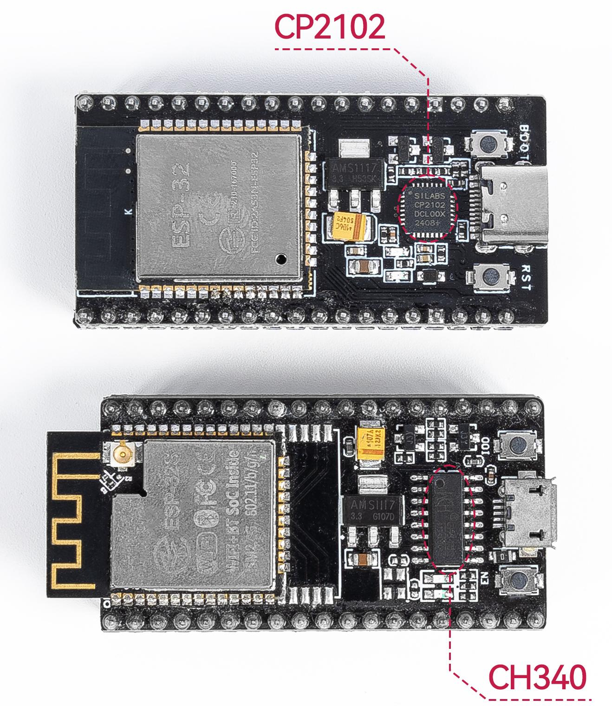

# Instalasi Driver ESP32 & STM32 (Ringkas)

## 1. Mengenali Chip Komunikasi pada Board
- **ESP32 DevKit** → chip USB-to-Serial dekat port USB: **CP2102/CP2104** (Silicon Labs, kotak persegi kecil) atau **CH340/CH340C/CH341/CH9102** (WCH, persegi panjang).

  
- **STM32 Blackpill (F401/F411)** → diprogram via **ST-Link V2** (SWD).

## 2. Bagian A: Windows (10/11)

> 💡 File driver lokal tersedia di folder **[`Driver/`](../Driver/)**:
> - ESP32 CP2102/CP2104: [`Driver/CP210x_Universal_Windows_Driver.zip`](../Driver/CP210x_Universal_Windows_Driver.zip)
> - ESP32 CH340/CH341: [`Driver/CH341SER.ZIP`](../Driver/CH341SER.ZIP)
> - STM32 (ST-Link V2): [`Driver/stsw-link009.zip`](../Driver/stsw-link009.zip)

### A.1 Driver ESP32
**Jika chip CP2102/CP2104:**
1. Ambil file lokal di atas, atau unduh dari `https://www.silabs.com/developers/usb-to-uart-bridge-vcp-drivers` (tab Downloads → CP210x Universal Windows Driver).
2. Ekstrak `.zip`.
3. Klik kanan **`silabser.inf`** → **Install** (atau jalankan `CP210xVCPInstaller_x64.exe`).
4. Tunggu sampai berhasil.

**Jika chip CH340/CH341:**
1. Ambil **[`Driver/CH341SER.ZIP`](../Driver/CH341SER.ZIP)** (lokal) atau unduh dari `https://www.wch-ic.com/downloads/CH341SER_ZIP.html`.
2. Ekstrak (jika .zip), jalankan **`SETUP.EXE`** → **INSTALL**.
3. Tunggu **"Driver install success!"** → **OK**.

### A.2 Driver STM32 (ST-Link V2)
1. Ambil file lokal di atas, atau unduh dari `https://www.st.com/en/development-tools/stsw-link009.html` → **Get Software** pada STSW-LINK009.
2. Ekstrak `stsw-link009.zip`.
3. Jalankan **`dpinst_amd64.exe`** (64-bit) atau **`dpinst_x86.exe`** (32-bit).
4. **Next** → **Finish**.

### A.3 Verifikasi di Device Manager
1. `Win + X` → **Device Manager**.
2. Colok **ESP32** → cek **Ports (COM & LPT)** → harus muncul `Silicon Labs CP210x USB to UART Bridge (COMx)` atau `USB-SERIAL CH340 (COMx)` tanpa tanda seru kuning.
3. Colok **ST-Link V2** → cek **Universal Serial Bus devices** → harus muncul `STM32 STLink` tanpa tanda seru kuning.

## 3. Bagian B: Linux (Udev Rules)

### B.1 Tambahkan User ke Grup Serial
- **Ubuntu/Debian/Mint/Pop!_OS/Fedora:**
  ```bash
  sudo usermod -a -G dialout,plugdev $USER
  ```
- **Arch/Manjaro:**
  ```bash
  sudo usermod -a -G uucp,lock $USER
  ```
> **Wajib Logout/Login kembali** (atau reboot) setelah menjalankan perintah ini.

### B.2 Pasang Udev Rules Resmi PlatformIO
1. ```bash
   curl -fsSL https://raw.githubusercontent.com/platformio/platformio-core/develop/platformio/assets/system/99-platformio-udev.rules | sudo tee /etc/udev/rules.d/99-platformio-udev.rules
   ```
2. ```bash
   sudo udevadm control --reload-rules
   sudo udevadm trigger
   ```
3. Cabut lalu colok kembali USB ESP32/ST-Link V2.

### B.3 Konflik `brltty` (Ubuntu/Debian, CH340 tidak muncul)
```bash
sudo apt remove brltty
```
Cabut dan colok kembali USB ESP32.

### B.4 Tool ST-Link di Linux (Opsional)
- **Ubuntu/Debian:**
  ```bash
  sudo apt update && sudo apt install libusb-1.0-0 stlink-tools
  ```
- **Fedora:**
  ```bash
  sudo dnf install stlink
  ```
- **Arch:**
  ```bash
  sudo pacman -S stlink
  ```

### B.5 Verifikasi di Terminal Linux
1. **ESP32:**
   ```bash
   ls -l /dev/ttyUSB* /dev/ttyACM*
   lsusb
   ```
   - `10c4:ea60` → Silicon Labs CP210x
   - `1a86:7523` → QinHeng Electronics CH340
2. **ST-Link V2 (STM32):**
   ```bash
   lsusb | grep -i st-link
   ```
   Contoh output: `Bus 001 Device 005: ID 0483:3748 STMicroelectronics ST-LINK/V2`

## 4. Troubleshooting

| Masalah | Penyebab & Solusi |
|---|---|
| **Port COM (Windows) / `/dev/ttyUSB0` (Linux) tidak muncul** saat ESP32 dicolokkan | Pastikan kabel USB mendukung data, bukan *charging-only*. Ganti kabel. |
| **Linux: `Permission denied: '/dev/ttyUSB0'`** | User belum masuk grup `dialout`/`uucp`, atau belum logout/restart setelah `sudo usermod`. |
| **Linux (Ubuntu): `/dev/ttyUSB0` muncul sebentar lalu hilang** | Konflik `brltty`. Jalankan `sudo apt remove brltty`, colok ulang ESP32. |
| **Windows: `Unknown USB Device` / tanda seru kuning** | Driver belum terinstal/salah. Pasang driver sesuai chip (CP2102 vs CH340). |
| **STM32: `Error: libusb_open() failed with LIBUSB_ERROR_ACCESS` (Linux)** | Udev rules belum terpasang/reload. Ulangi **B.2**, colok ulang ST-Link. |
| **STM32: ST-Link terdeteksi tapi `No target connected`** | Periksa 4 kabel SWDIO, SWCLK, GND, 3.3V, jangan tertukar SWDIO/SWCLK. |
