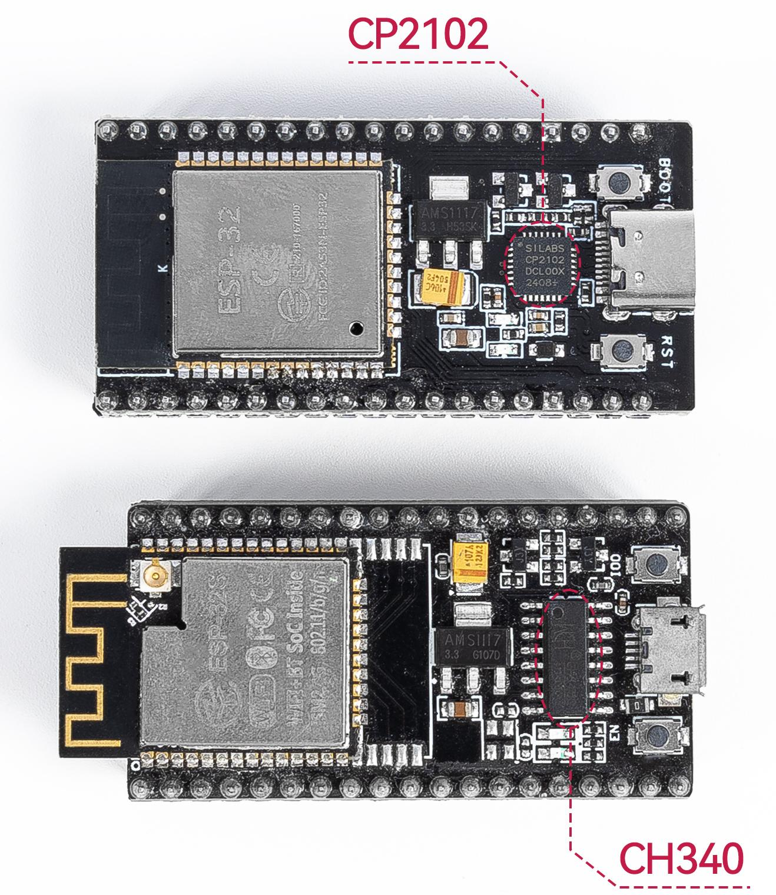

# Tutorial Instalasi Driver ESP32 & STM32 (Windows & Linux)

Panduan ini menjelaskan langkah-langkah menyiapkan driver dan izin akses (*permissions*) perangkat USB pada **Windows (10/11)** dan **Linux (Ubuntu/Debian, Fedora, Arch)** agar board **ESP32** dan **STM32 (via ST-Link)** dapat terdeteksi dan di-*upload* melalui VSCode + PlatformIO.

---

## Daftar Isi
1. [Mengenali Chip Komunikasi pada Board](#1-mengenali-chip-komunikasi-pada-board)
2. [Bagian A — Instalasi Driver di Windows (10/11)](#2-bagian-a--instalasi-driver-di-windows-1011)
   - [A.1 Driver ESP32 (CP210x & CH340)](#a1-driver-esp32-cp210x--ch340)
   - [A.2 Driver STM32 (ST-Link V2)](#a2-driver-stm32-st-link-v2)
   - [A.3 Verifikasi di Device Manager Windows](#a3-verifikasi-di-device-manager-windows)
3. [Bagian B — Konfigurasi Driver & Udev Rules di Linux](#3-bagian-b--konfigurasi-driver--udev-rules-di-linux)
   - [B.1 Menambahkan User ke Grup Serial (`dialout` / `uucp`)](#b1-menambahkan-user-ke-grup-serial-dialout--uucp)
   - [B.2 Memasang Aturan `udev` Resmi PlatformIO (ESP32 & ST-Link)](#b2-memasang-aturan-udev-resmi-platformio-esp32--st-link)
   - [B.3 Mengatasi Konflik `brltty` pada Ubuntu/Debian (Chip CH340 tidak muncul)](#b3-mengatasi-konflik-brltty-pada-ubuntudebian-chip-ch340-tidak-muncul)
   - [B.4 Instalasi Tool ST-Link di Linux (Opsional)](#b4-instalasi-tool-st-link-di-linux-opsional)
   - [B.5 Verifikasi di Terminal Linux](#b5-verifikasi-di-terminal-linux)
4. [Troubleshooting (Masalah Umum)](#4-troubleshooting-masalah-umum)

---

## 1. Mengenali Chip Komunikasi pada Board

Sebelum menginstal driver, perhatikan komponen yang digunakan:

1. **ESP32 DevKit** berkomunikasi dengan komputer melalui chip konverter **USB-to-Serial (UART)** kecil yang terletak di dekat port USB board. Dua jenis chip yang paling umum adalah:
   - **Silicon Labs CP2102 / CP2104:** berbentuk kotak persegi kecil.
   - **WCH CH340 / CH340C / CH341 / CH9102:** umumnya berbentuk persegi panjang dengan kaki di dua sisi.

   

2. **STM32 Blackpill (STM32F401 / STM32F411)** pada praktikum ini diprogram menggunakan *debugger/programmer* eksternal **ST-Link V2** melalui jalur *Serial Wire Debug* (SWD).

---

## 2. Bagian A — Instalasi Driver di Windows (10/11)

> 💡 **File Driver Lokal Tersedia:** Repositori ini sudah menyediakan file `.zip` installer driver di dalam folder **[`Driver/`](Driver/)** untuk memudahkan instalasi tanpa perlu mengunduh ulang dari internet:
> - **ESP32 (CP2102/CP2104):** [`Driver/CP210x_Universal_Windows_Driver.zip`](Driver/CP210x_Universal_Windows_Driver.zip)
> - **STM32 (ST-Link V2):** [`Driver/stsw-link009.zip`](Driver/stsw-link009.zip)

### A.1 Driver ESP32 (CP210x & CH340)

#### 1. Jika Board Menggunakan Chip CP2102 / CP2104 (Silicon Labs)
1. **Pilih salah satu sumber file driver:**
   - **Opsi 1 (Dari Folder Lokal — Disarankan):** Ambil langsung file **[`Driver/CP210x_Universal_Windows_Driver.zip`](Driver/CP210x_Universal_Windows_Driver.zip)** yang sudah tersedia di repositori ini.
   - **Opsi 2 (Unduh dari Situs Resmi):** Kunjungi halaman resmi Silicon Labs di `https://www.silabs.com/developers/usb-to-uart-bridge-vcp-drivers`, buka tab **Downloads**, lalu unduh **CP210x Universal Windows Driver**.
2. Ekstrak file `.zip` tersebut ke sebuah folder.
3. Di dalam folder hasil ekstrak, klik kanan file **`silabser.inf`** → pilih **Install** (atau jalankan `CP210xVCPInstaller_x64.exe` jika menggunakan paket VCP Installer).
4. Ikuti jendela instalasi hingga muncul pesan berhasil.

   

#### 2. Jika Board Menggunakan Chip CH340 / CH341 (WCH)
1. Kunjungi halaman resmi WCH:
   ```
   https://www.wch-ic.com/downloads/CH341SER_ZIP.html
   ```
2. Unduh file **`CH341SER.ZIP`** atau **`CH341SER.EXE`**.
3. Ekstrak (jika `.zip`), jalankan **`SETUP.EXE`**, lalu klik tombol **INSTALL**.
4. Tunggu hingga muncul pesan **"Driver install success!"**, lalu klik **OK**.

---

### A.2 Driver STM32 (ST-Link V2)

1. **Pilih salah satu sumber file driver:**
   - **Opsi 1 (Dari Folder Lokal — Disarankan):** Ambil langsung file **[`Driver/stsw-link009.zip`](Driver/stsw-link009.zip)** yang sudah tersedia di dalam folder `Driver/` pada repositori ini (tanpa perlu membuat akun di situs ST).
   - **Opsi 2 (Unduh dari Situs Resmi):** Kunjungi halaman resmi STMicroelectronics di `https://www.st.com/en/development-tools/stsw-link009.html`, lalu klik **Get Software** pada baris **STSW-LINK009**.

   

2. Ekstrak file `stsw-link009.zip` tersebut ke sebuah folder.
3. Jalankan file **`dpinst_amd64.exe`** (untuk Windows 64-bit) atau **`dpinst_x86.exe`** (untuk Windows 32-bit).
4. Klik **Next** → **Finish** hingga proses instalasi selesai.

---

### A.3 Verifikasi di Device Manager Windows

1. Tekan `Win + X`, lalu pilih **Device Manager**.
2. Colokkan board **ESP32** ke port USB komputer:
   - Buka kategori **Ports (COM & LPT)**.
   - Pastikan muncul **`Silicon Labs CP210x USB to UART Bridge (COMx)`** atau **`USB-SERIAL CH340 (COMx)`** tanpa tanda seru kuning (`!`).
3. Colokkan **ST-Link V2** ke port USB komputer:
   - Buka kategori **Universal Serial Bus devices** (atau **STMicroelectronics STLink dongle**).
   - Pastikan muncul **`STM32 STLink`** tanpa tanda seru kuning (`!`).

---

## 3. Bagian B — Konfigurasi Driver & Udev Rules di Linux

Pada sistem operasi **Linux**, driver kernel untuk CP210x (`cp210x`) dan CH340 (`ch341`) **sudah terinstal secara bawaan** di dalam kernel. Namun, secara default pengguna biasa (*non-root*) **tidak memiliki izin akses** ke port serial (`/dev/ttyUSB0`, `/dev/ttyACM0`) maupun perangkat USB ST-Link.

Ikuti langkah-langkah berikut agar PlatformIO dapat mengakses ESP32 dan STM32 tanpa `sudo`:

### B.1 Menambahkan User ke Grup Serial (`dialout` / `uucp`)

Buka Terminal, lalu jalankan perintah sesuai distribusi Linux yang Anda gunakan:

- **Ubuntu / Debian / Linux Mint / Pop!_OS / Fedora:**
  ```bash
  sudo usermod -a -G dialout,plugdev $USER
  ```
- **Arch Linux / Manjaro:**
  ```bash
  sudo usermod -a -G uucp,lock $USER
  ```

> **Penting:** Setelah menjalankan perintah di atas, Anda **wajib Logout lalu Login kembali** (atau *reboot* komputer) agar perubahan grup pengguna aktif.

---

### B.2 Memasang Aturan `udev` Resmi PlatformIO (ESP32 & ST-Link)

Agar ST-Link V2, DFU STM32, dan berbagai board ESP32 dapat diakses langsung oleh PlatformIO tanpa hak akses *root*, pasang file aturan `99-platformio-udev.rules` resmi:

1. Unduh dan pasang file aturan `udev` ke `/etc/udev/rules.d/`:
   ```bash
   curl -fsSL https://raw.githubusercontent.com/platformio/platformio-core/develop/platformio/assets/system/99-platformio-udev.rules | sudo tee /etc/udev/rules.d/99-platformio-udev.rules
   ```
2. Muat ulang layanan `udev` agar aturan baru langsung diterapkan:
   ```bash
   sudo udevadm control --reload-rules
   sudo udevadm trigger
   ```
3. Cabut lalu colokkan kembali kabel USB ESP32 atau ST-Link V2 Anda.

---

### B.3 Mengatasi Konflik `brltty` pada Ubuntu/Debian (Chip CH340 tidak muncul)

Pada **Ubuntu 22.04 / 24.04** dan turunannya, layanan pembaca layar Braille bawaan bernama **`brltty`** sering kali mengambil alih chip **CH340** secara otomatis, sehingga port `/dev/ttyUSB0` tiba-tiba hilang sesaat setelah ESP32 dicolokkan.

Jika Anda mencolokkan ESP32 (CH340) tetapi `/dev/ttyUSB0` tidak muncul, hapus atau nonaktifkan `brltty`:
```bash
sudo apt remove brltty
```
Setelah selesai, cabut dan colokkan kembali kabel USB ESP32.

---

### B.4 Instalasi Tool ST-Link di Linux (Opsional)

PlatformIO sebenarnya sudah mengunduh paket `tool-openocd` dan `tool-stlink` secara otomatis saat *upload* pertama kali. Namun jika Anda ingin memeriksa koneksi ST-Link lewat terminal (`st-info --probe`), Anda dapat menginstal paket `stlink-tools`:

- **Ubuntu / Debian:**
  ```bash
  sudo apt update && sudo apt install libusb-1.0-0 stlink-tools
  ```
- **Fedora:**
  ```bash
  sudo dnf install stlink
  ```
- **Arch Linux:**
  ```bash
  sudo pacman -S stlink
  ```

---

### B.5 Verifikasi di Terminal Linux

1. **Verifikasi ESP32:**
   Colokkan ESP32 ke USB, lalu jalankan:
   ```bash
   ls -l /dev/ttyUSB* /dev/ttyACM*
   ```
   Jika berhasil, akan muncul perangkat seperti `/dev/ttyUSB0` dengan grup `dialout` (atau `uucp`). Anda juga dapat melihat chip yang terdeteksi dengan:
   ```bash
   lsusb
   ```
   - `10c4:ea60` → Silicon Labs CP210x
   - `1a86:7523` → QinHeng Electronics CH340

2. **Verifikasi ST-Link V2 (STM32):**
   Colokkan ST-Link V2 ke USB, lalu jalankan:
   ```bash
   lsusb | grep -i st-link
   ```
   Akan muncul baris seperti:
   `Bus 001 Device 005: ID 0483:3748 STMicroelectronics ST-LINK/V2`

---

## 4. Troubleshooting (Masalah Umum)

| Masalah | Penyebab & Solusi |
|---|---|
| **Port COM (Windows) / `/dev/ttyUSB0` (Linux) sama sekali tidak muncul** saat ESP32 dicolokkan | Pastikan kabel USB yang digunakan adalah **kabel data**, bukan kabel *charging-only* (kabel bawaan *powerbank*/kipas mini umumnya tidak memiliki jalur data D+/D-). Coba ganti kabel USB. |
| **Linux: `Permission denied: '/dev/ttyUSB0'`** saat upload atau buka Serial Monitor | User belum masuk ke grup `dialout`/`uucp`, atau belum **Logout/Restart** setelah menjalankan `sudo usermod`. |
| **Linux (Ubuntu): `/dev/ttyUSB0` muncul sebentar lalu langsung hilang** | Terjadi konflik dengan layanan `brltty`. Jalankan `sudo apt remove brltty` lalu colokkan ulang ESP32. |
| **Windows: Muncul `Unknown USB Device` atau tanda seru kuning (`!`) di Device Manager** | Driver belum terinstal atau versi driver salah. Pastikan menginstal driver sesuai tipe chip pada board (CP2102 vs CH340). |
| **STM32: `Error: libusb_open() failed with LIBUSB_ERROR_ACCESS` (Linux)** | Aturan `99-platformio-udev.rules` belum terpasang atau `udevadm` belum di-*reload*. Ulangi langkah **B.2**, lalu cabut dan colokkan ulang ST-Link. |
| **STM32: ST-Link terdeteksi di USB, tetapi gagal mendeteksi chip (`No target connected`)** | Periksa kembali 4 kabel antara ST-Link V2 dan STM32 Blackpill (`SWDIO`, `SWCLK`, `GND`, dan `3.3V`) — pastikan tidak tertukar antara `SWDIO` dan `SWCLK`. |
