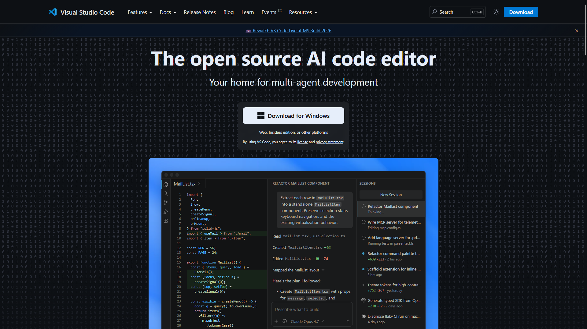
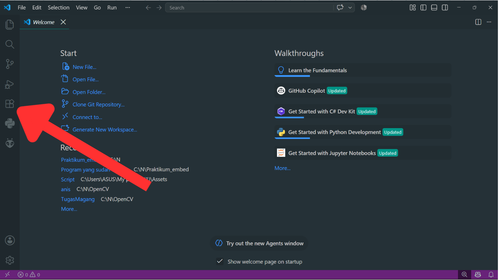
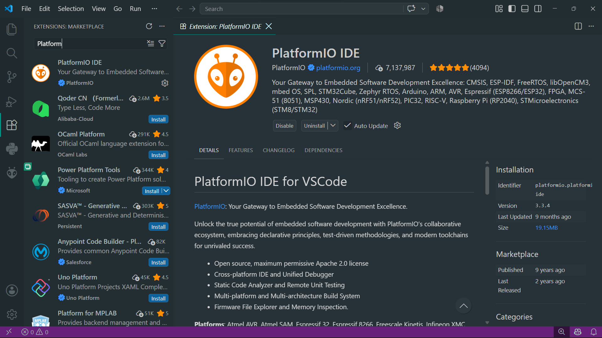
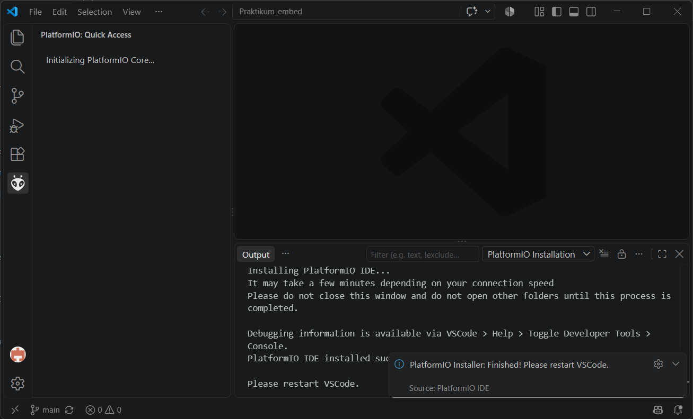
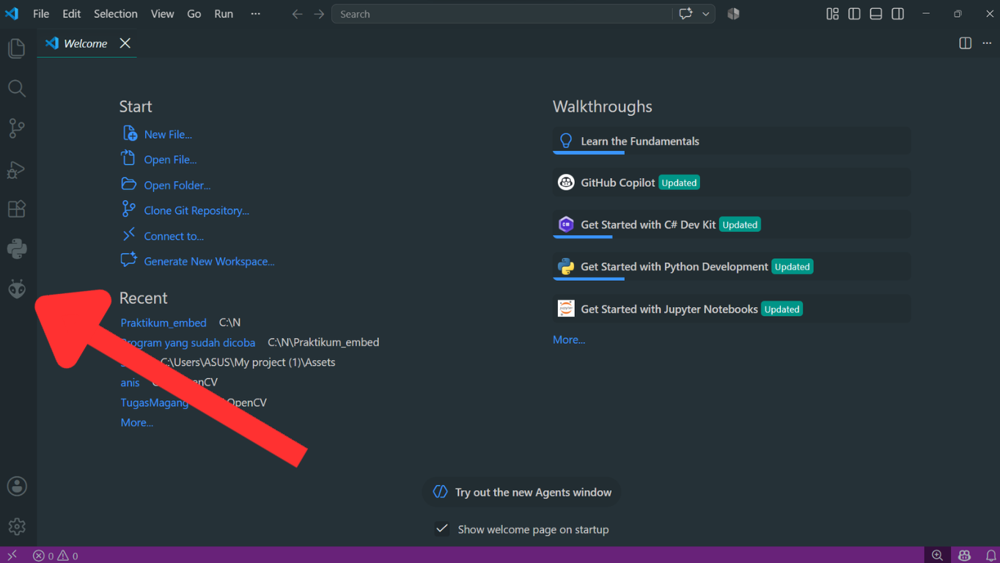
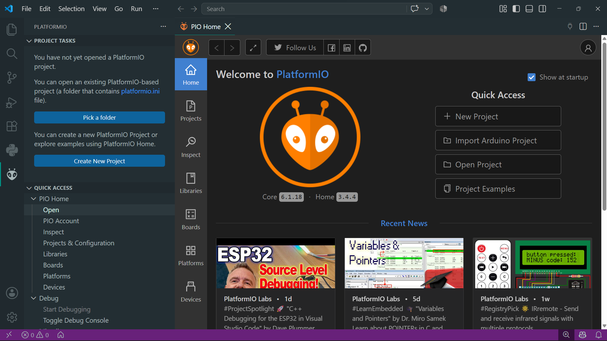
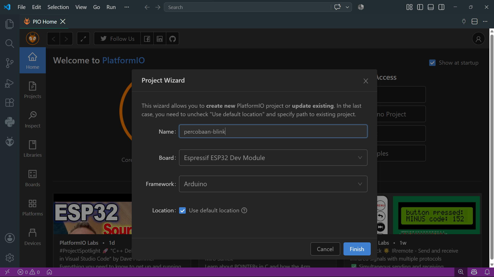
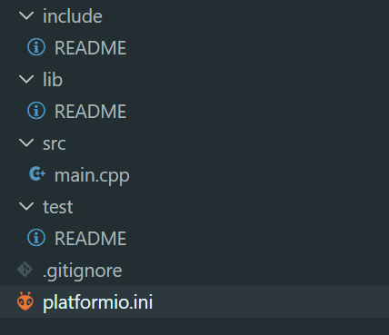
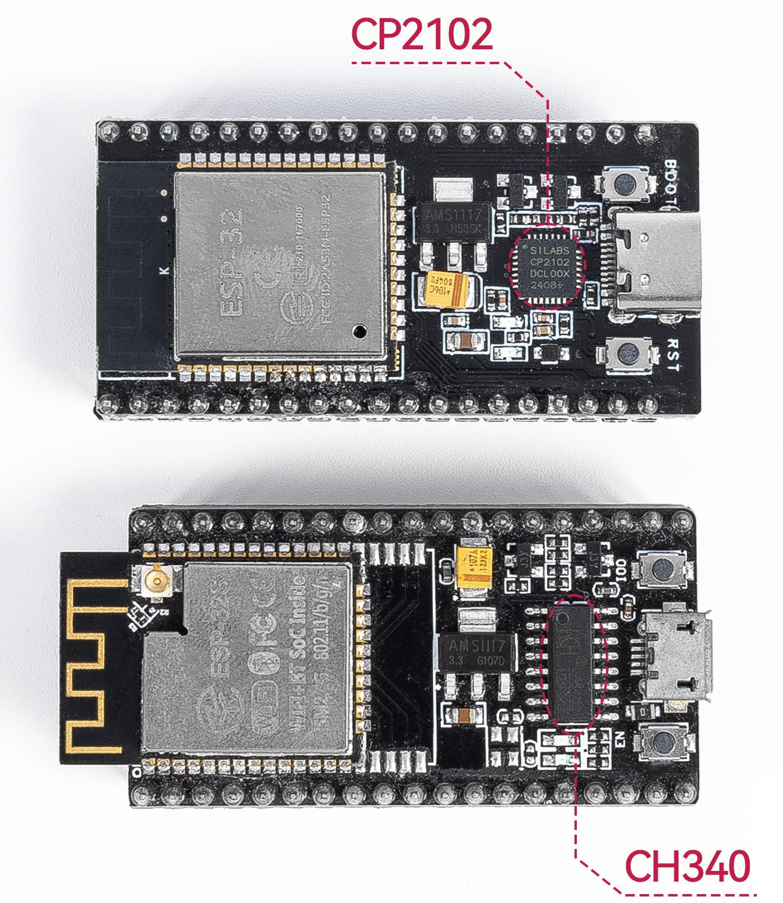

# Setup VSCode & PlatformIO (Ringkas)

## 1. Instalasi Visual Studio Code
1. Buka `https://code.visualstudio.com/` → klik **Download**.

   
2. Jalankan installer yang terdownload.
3. Centang **"I accept the agreement"** → **Next**.
4. Biarkan lokasi default → **Next**.
5. Pada **Select Additional Tasks**, centang:
   - ☑ *Add "Open with Code" action to Windows Explorer file context menu*
   - ☑ *Add to PATH*
6. Klik **Install** → tunggu → **Finish** (biarkan *Launch Visual Studio Code* tercentang).
7. VSCode terbuka otomatis ke halaman **Welcome**.

## 2. Instalasi Ekstensi PlatformIO
1. Klik ikon **Extensions** di sidebar kiri, atau `Ctrl+Shift+X`.

   
2. Ketik **"PlatformIO IDE"** di kotak pencarian.
3. Pilih ekstensi resmi PlatformIO (logo semut 🐜) → **Install**.

   
4. Tunggu proses instalasi selesai (PlatformIO Core terunduh otomatis).

   
5. Klik **reload/restart window** jika diminta.
6. Pastikan ikon PlatformIO (semut 🐜) muncul di sidebar kiri.

   

## 3. Membuat Project Baru
1. Klik ikon PlatformIO → **"Open"** / **"PIO Home"**.

   
2. Klik **"+ New Project"**.
3. Isi form:
   - **Name:** nama project (contoh: `percobaan-blink`)
   - **Board:** `esp32dev` (ESP32) atau **Blackpill F411CE/F401CC** (STM32)
   - **Framework:** **Arduino** atau **STM32Cube**
   - **Location:** default, atau folder lain

   
4. Klik **Finish** → tunggu PlatformIO mengunduh package yang dibutuhkan.

## 4. Struktur Folder Project

```
nama-project/
├── .pio/            <- folder otomatis, berisi file hasil build (jangan diedit manual)
├── .vscode/         <- pengaturan khusus VSCode untuk project ini
├── include/         <- tempat menyimpan file header (.h) custom
├── lib/             <- tempat menyimpan library yang kamu buat sendiri
├── src/
│   └── main.cpp     <- FILE UTAMA tempat kamu menulis kode program!
├── test/            <- tempat menulis unit test (jarang dipakai di praktikum ini)
└── platformio.ini   <- FILE KONFIGURASI project (board, framework, library, dst.)
```



## 5. Toolbar PlatformIO (status bar bawah)

| Ikon | Nama | Fungsi |
|---|---|---|
| ✓ (centang) | **Build** | Kompilasi tanpa upload |
| → (panah kanan) | **Upload** | Kompilasi + upload ke board |
| 🔌 (colokan) | **Serial Monitor** | Lihat output `Serial.print()` |
| 🗑 (tempat sampah) | **Clean** | Bersihkan hasil build |
| 🏠 (rumah) | **PIO Home** | Kembali ke PlatformIO Home |

## 6. Instalasi Driver USB

> 📖 Lihat panduan lengkap: **[setup_driver_esp32_dan_stm32.md](setup_driver_esp32_dan_stm32.md)**

### 6.1 STM32 (ST-Link)
1. Ambil **[`Driver/stsw-link009.zip`](../Driver/stsw-link009.zip)** (lokal) atau unduh dari `https://www.st.com/en/development-tools/stsw-link009.html`.
2. Ekstrak → jalankan `dpinst_amd64.exe` (Windows 64-bit) → ikuti instruksi.

### 6.2 ESP32 (USB-to-Serial)
1. Cek chip di board:
   - CP2102/CP2104 → **[`Driver/CP210x_Universal_Windows_Driver.zip`](../Driver/CP210x_Universal_Windows_Driver.zip)** atau `https://www.silabs.com/developers/usb-to-uart-bridge-vcp-drivers`
   - CH340/CH340C/CH341 → **[`Driver/CH341SER.ZIP`](../Driver/CH341SER.ZIP)** atau `https://www.wch-ic.com/downloads/CH341SER_ZIP.html`

   
2. Ekstrak (jika .zip) → jalankan installer → ikuti instruksi.
3. **Restart laptop/PC** setelah instalasi selesai.

## 7. Uji Coba: Upload Program Pertama
1. Buat project baru (Langkah 3) dengan board ESP32 + framework Arduino.
2. Sambungkan board via USB.
3. Isi `src/main.cpp`:
   ```cpp
   #include <Arduino.h>

   void setup() {
     Serial.begin(115200);
     Serial.println("Halo, PlatformIO berhasil disetup!");
   }

   void loop() {
     Serial.println("Program berjalan...");
     delay(1000);
   }
   ```
4. Klik ikon **Upload (→)**.
5. Tunggu sampai muncul `[SUCCESS]`.
6. Klik ikon **Serial Monitor (🔌)** → set baud rate **115200**.
7. Pastikan muncul "Halo, PlatformIO berhasil disetup!" dan "Program berjalan..." setiap 1 detik.

## 8. Troubleshooting

| Masalah | Kemungkinan Penyebab & Solusi |
|---|---|
| Board tidak muncul di daftar **Port** saat mau upload | Driver USB belum terinstal dengan benar, atau kabel USB hanya kabel **charging**. Ganti kabel USB. |
| Upload gagal, **"Failed to connect"** (ESP32) | Tekan dan tahan tombol **BOOT/FLASH**, lepas begitu upload mulai berjalan. |
| Upload STM32 gagal, ST-Link tidak terdeteksi | Periksa kabel SWDIO, SWCLK, GND, 3.3V dari ST-Link ke board. |
| Serial Monitor menampilkan karakter aneh | Samakan baud rate dengan `Serial.begin()` (umumnya 115200). |
| Instalasi PlatformIO Core macet/gagal | Periksa koneksi internet, restart VSCode, ulangi instalasi ekstensi. |
| Port serial "sedang dipakai" (`Port busy`/`Access denied`) | Tutup aplikasi lain yang membuka port tersebut. |
| Build gagal karena library tidak ditemukan | Pastikan `lib_deps` di `platformio.ini` sudah benar, build ulang. |

## 9. (Opsional) Priming Package & Library ke Cache Lokal
1. Buka terminal VSCode (`` Ctrl+` `` atau menu **Terminal → New Terminal**), `pio` sudah otomatis ada di PATH setelah PlatformIO IDE terinstal.
   > **Windows:** Jika `pio` belum dikenali, restart VSCode (atau komputer) agar PATH ter-update. Jika masih gagal, buka lewat Command Palette (`Ctrl+Shift+P`) → **`PlatformIO: New Terminal`**.
2. Unduh platform/toolchain:
   ```bash
   pio pkg install --platform espressif32
   pio pkg install --platform ststm32
   ```
3. *(Opsional)* Buat project sementara dengan `platformio.ini`:
   ```ini
   [env:esp32dev]
   platform = espressif32
   board = esp32dev
   framework = arduino
   lib_deps =
       adafruit/Adafruit SH110X@^2.1.11
       adafruit/Adafruit GFX Library@^1.11.9
       madhephaestus/ESP32Servo@^3.0.0
   ```
   Jalankan **`pio run`** sekali, lalu hapus project ini.

## 10. Referensi
1. Visual Studio Code Official Documentation, https://code.visualstudio.com/docs
2. PlatformIO Documentation, https://docs.platformio.org/
3. STMicroelectronics, *STSW-LINK009, ST-Link USB Driver*, https://www.st.com/en/development-tools/stsw-link009.html
4. Silicon Labs, *CP210x USB to UART Bridge VCP Drivers*, https://www.silabs.com/developers/usb-to-uart-bridge-vcp-drivers
5. WCH, *CH340/CH341 Driver*, https://www.wch-ic.com/downloads/CH341SER_ZIP.html
